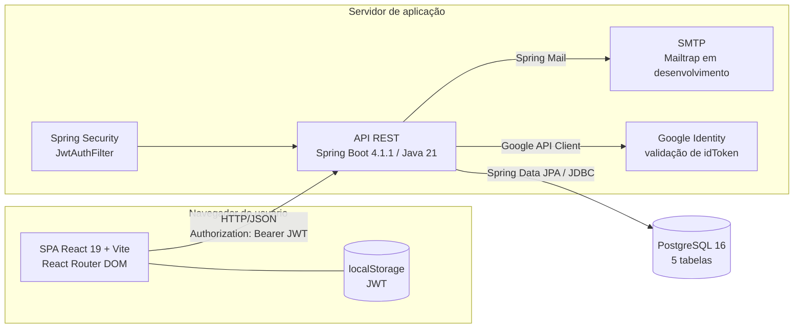
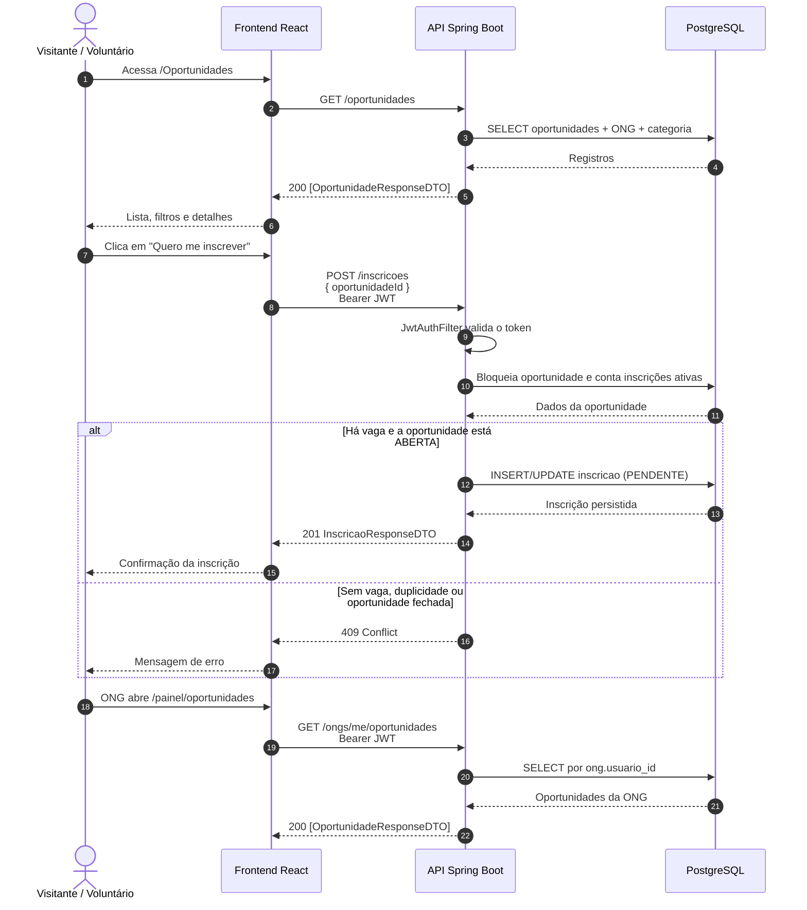

<div align="center">

# 💜 Conecte-Bem

**Conectando voluntários a ONGs para transformar realidades.**

[](https://www.oracle.com/java/)
[](https://spring.io/projects/spring-boot)
[](https://react.dev/)
[](https://vite.dev/)
[](https://www.postgresql.org/)
[](https://jwt.io/)

[](#18-equipe-de-desenvolvimento)
[](#20-limitações-e-pontos-a-validar)
[](#16-como-executar-os-testes)
[](#16-como-executar-os-testes)

[📖 Documentação](docs/README.md) · [🛠️ Backend](backend/README.md) · [🎨 Frontend](frontend/README.md) · [🗺️ Diagramas](docs/assets/diagrams/README.md)

</div>

---

## Sumário

- [1. Visão geral](#1-visão-geral)
- [2. Objetivo](#2-objetivo)
- [3. Problema que o projeto resolve](#3-problema-que-o-projeto-resolve)
- [4. Público-alvo](#4-público-alvo)
- [5. Solução proposta](#5-solução-proposta)
- [6. Funcionalidades implementadas](#6-funcionalidades-implementadas)
- [7. Tecnologias utilizadas](#7-tecnologias-utilizadas)
- [8. Arquitetura geral](#8-arquitetura-geral)
- [9. Comunicação entre frontend, backend e banco](#9-comunicação-entre-frontend-backend-e-banco)
- [10. Estrutura de diretórios](#10-estrutura-de-diretórios)
- [11. Pré-requisitos](#11-pré-requisitos)
- [12. Instalação e configuração](#12-instalação-e-configuração)
- [13. Configuração do banco de dados](#13-configuração-do-banco-de-dados)
- [14. Como executar o backend](#14-como-executar-o-backend)
- [15. Como executar o frontend](#15-como-executar-o-frontend)
- [16. Como executar os testes](#16-como-executar-os-testes)
- [17. Documentação do projeto](#17-documentação-do-projeto)
- [18. Equipe de desenvolvimento](#18-equipe-de-desenvolvimento)
- [19. Melhorias futuras](#19-melhorias-futuras)
- [20. Limitações e pontos a validar](#20-limitações-e-pontos-a-validar)
- [21. Licença e uso](#21-licença-e-uso)

---

## 1. Visão geral

O **Conecte-Bem** é uma aplicação web full stack para aproximar **voluntários** de **organizações não governamentais (ONGs)**. A plataforma permite que ONGs publiquem oportunidades de voluntariado e que voluntários encontrem ações compatíveis com seus interesses, se candidatem e acompanhem suas inscrições.

O projeto é um **Projeto Final de Conclusão +Prati — Bootcamp Full Stack** e está organizado em dois módulos independentes:

| Módulo | Responsabilidade | Documentação |
|---|---|---|
| **Backend** | API REST, autenticação JWT, regras de negócio e persistência | [backend/README.md](backend/README.md) |
| **Frontend** | Interface React, navegação, formulários e consumo da API | [frontend/README.md](frontend/README.md) |

> **Estado do projeto:** versão final acadêmica com as funcionalidades principais implementadas e as suítes de testes aprovadas. Itens não concluídos ou fora do escopo estão identificados em [Limitações e pontos a validar](#20-limitações-e-pontos-a-validar) e não são apresentados como prontos.

---

## 2. Objetivo

Criar um canal simples, acessível e seguro para que:

- **ONGs** divulguem oportunidades de voluntariado e gerenciem as candidaturas recebidas;
- **voluntários** encontrem causas, consultem detalhes e se inscrevam em poucos passos;
- **os dois lados** mantenham um histórico organizado de oportunidades e inscrições.

O objetivo técnico é aplicar, em um produto real, uma arquitetura em camadas com **Java 21 + Spring Boot**, **React 19 + Vite** e **PostgreSQL**, incluindo autenticação stateless com JWT, validações de domínio e testes automatizados.

---

## 3. Problema que o projeto resolve

Muitas ONGs divulgam vagas de voluntariado por redes sociais, grupos de mensagem e planilhas. Esse formato dificulta:

- a descoberta de oportunidades por pessoas interessadas em ajudar;
- o controle de vagas e de candidaturas;
- a comunicação entre ONG e voluntário;
- a preservação do histórico de inscrições;
- a confiança de que a oportunidade ainda está aberta.

O Conecte-Bem centraliza esse fluxo em uma única aplicação: a ONG publica a ação, o voluntário se inscreve e a organização acompanha quem se candidatou.

---

## 4. Público-alvo

| Público | Necessidade atendida |
|---|---|
| **Voluntários** | Encontrar oportunidades por causa, local, ONG e status, inscrever-se e acompanhar candidaturas. |
| **ONGs** | Divulgar ações, controlar vagas, consultar inscritos e confirmar ou cancelar candidaturas. |
| **Visitantes** | Conhecer a plataforma, consultar oportunidades públicas e enviar mensagens pelo formulário de contato. |
| **Equipe acadêmica** | Avaliar a aplicação full stack, a organização do código, a documentação e os testes. |

---

## 5. Solução proposta

A solução é uma **SPA (Single Page Application)** React que consome uma **API REST** Spring Boot, com persistência em PostgreSQL.

```text
Visitante → consulta oportunidades públicas
Voluntário → cria conta, autentica, inscreve-se e acompanha candidaturas
ONG       → cria conta, autentica, publica oportunidades e gerencia inscritos
```

Principais decisões técnicas:

- **Autenticação stateless** com JWT assinado em HMAC256 e senha protegida com BCrypt.
- **Autorização por papel** (`ROLE_VOLUNTARIO` e `ROLE_ONG`) no Spring Security, complementada por validação de propriedade na camada de serviço.
- **DTOs** para entrada e saída, evitando expor entidades JPA diretamente.
- **Regras de negócio no backend**, incluindo controle de vagas, reativação de inscrição cancelada e cálculo de vagas disponíveis.
- **Frontend em React** com React Router DOM, contexto de autenticação e serviços HTTP centralizados.

---

## 6. Funcionalidades implementadas

### 6.1 Autenticação e contas

| Funcionalidade | Estado | Observação |
|---|---|---|
| Cadastro de voluntário | ✅ Implementado | Exige data de nascimento e idade mínima de 18 anos. |
| Cadastro de ONG | ✅ Implementado | Valida CNPJ e cria o registro em `usuarios` e `ongs` na mesma transação. |
| Login com e-mail e senha | ✅ Implementado | Retorna JWT com validade de 2 horas. |
| Login com Google | ✅ Implementado no backend | Endpoint disponível; não há botão nem fluxo no frontend. Somente contas já cadastradas. |
| Logout no frontend | ✅ Implementado | Remove o token do `localStorage`. |
| Recuperação de senha | ⚠️ Apenas interface | A tela existe, mas não há endpoint de recuperação no backend. |

### 6.2 ONGs

- Consulta pública de ONGs (`GET /ongs` e `GET /ongs/{id}`).
- Perfil da ONG autenticada (`GET /ongs/me` e `PUT /ongs/me`).
- Painel com indicadores: total de oportunidades, ativas, encerradas e voluntários inscritos.
- Listagem das oportunidades da própria ONG.

### 6.3 Oportunidades

- Listagem pública com filtros opcionais por cidade, categoria ou status na API, com paginação (`page`/`size`) e total no cabeçalho `X-Total-Count`.
- Busca por ID.
- Criação e edição pelo frontend; o botão **Cancelar** altera o status para `CANCELADA` (exclusão lógica). O `DELETE /oportunidades/{id}` da API também aplica cancelamento lógico, preservando inscrições e histórico.
- Controle de capacidade: não é possível reduzir vagas abaixo do número de inscrições ativas.
- Exibição de inscritos e vagas disponíveis calculados no servidor.

### 6.4 Inscrições

- Voluntário se inscreve em oportunidade `ABERTA` com vaga disponível.
- Uma inscrição ativa por voluntário e oportunidade.
- Cancelamento pelo voluntário.
- Reativação de inscrição cancelada, sem duplicar registros.
- ONG proprietária lista inscritos, confirma ou cancela candidaturas.
- Controle de concorrência com bloqueio pessimista na oportunidade.

### 6.5 Perfis e contato

- Perfil do voluntário (`GET` e `PUT /voluntarios/me`), com nome editável.
- Perfil da ONG com nome, descrição, telefone, cidade e estado editáveis.
- Formulário público de contato com envio de e-mail via SMTP.
- Health check público em `GET /health`.

### 6.6 Categorias

- Consulta pública de categorias (`GET /categorias` e `GET /categorias/{id}`).
- Criação, edição e exclusão existem no controller, mas estão **bloqueadas por `denyAll`** no estado atual, pois ainda não há perfil de administrador. Ver [backend/README.md](backend/README.md#128-módulo-categorias).

---

## 7. Tecnologias utilizadas

### Backend

| Tecnologia | Versão declarada | Uso |
|---|---|---|
| Java | 21 | Linguagem e runtime |
| Spring Boot | 4.1.1 | Base da aplicação |
| Spring Web MVC | Gerenciado pelo Boot | API REST |
| Spring Data JPA / Hibernate | Gerenciado pelo Boot | Persistência |
| Spring Security | Gerenciado pelo Boot | Autenticação e autorização |
| java-jwt (Auth0) | 4.5.0 | Geração e validação de JWT |
| Bean Validation | Gerenciado pelo Boot | Validação de DTOs |
| Spring Mail | Gerenciado pelo Boot | Envio de e-mail do contato |
| Google API Client | 2.7.2 | Validação de `idToken` do Google |
| PostgreSQL Driver | Gerenciado pelo Boot | Conexão com PostgreSQL |
| Lombok | Gerenciado pelo Boot | Redução de boilerplate |
| H2 | Gerenciado pelo Boot | Banco em memória nos testes |
| JUnit / Spring Boot Test | Gerenciado pelo Boot | Testes automatizados |
| Maven Wrapper | Incluído no projeto | Build e execução |

### Frontend

| Tecnologia | Versão declarada | Uso |
|---|---|---|
| React | 19.2.8 | Interface |
| React DOM | 19.2.8 | Renderização |
| React Router DOM | 7.18.5 | Rotas da SPA |
| Vite | 8.2.2 | Dev server e build |
| ESLint | 10.9.0 | Análise estática |
| Font Awesome | 7.3.1 | Ícones |
| react-icons | 5.7.0 | Ícones |
| Jest | 30.5.2 | Testes de componentes e serviços |
| Testing Library | React / DOM / user-event | Testes de interface |
| Node.js `node:test` | Runtime local | Testes de utilitários |

### Banco e infraestrutura

| Tecnologia | Versão | Uso |
|---|---|---|
| PostgreSQL | 16 (imagem Docker) | Banco relacional |
| pgAdmin 4 | Imagem `dpage/pgadmin4` | Administração local do banco |
| Docker Compose | Arquivo `backend/docker-compose.yml` | Sobe banco e pgAdmin |

> O projeto **não utiliza** TypeScript, Redux, Axios, Tailwind CSS, Flyway ou Liquibase.

---

## 8. Arquitetura geral



**Características da arquitetura:**

- Cliente e servidor são aplicações separadas, executadas em portas diferentes no desenvolvimento (`5173` e `8080`).
- A API é **stateless**: o usuário é identificado pelo JWT enviado no cabeçalho `Authorization`.
- O frontend não acessa o banco diretamente; toda regra de negócio passa pela API.
- O backend segue camadas `controller → service → repository → entity`, com DTOs e tratamento global de exceções.
- A integração com Google e SMTP é feita apenas no backend; credenciais não ficam no frontend.

---

## 9. Comunicação entre frontend, backend e banco



**Resumo do contrato:**

- Formato de dados: **JSON**.
- URL padrão da API: `http://localhost:8080`.
- Autenticação: `Authorization: Bearer <token>`.
- O frontend trata `204 No Content` como resposta sem corpo.
- Erros do backend seguem o formato `{ timestamp, status, erro, mensagem }` quando tratados pelo `GlobalExceptionHandler`; respostas de segurança `401`/`403` têm formato reduzido `{ status, erro, mensagem }`.
- Os detalhes de cada rota estão em [backend/README.md](backend/README.md#12-documentação-dos-endpoints).

---

## 10. Estrutura de diretórios

```text
conecte-bem/
├── backend/
│   ├── db/
│   │   ├── schema.sql                         # Schema completo para base vazia
│   │   └── migrations/
│   │       ├── 20261110_qa009_dados_cadastro.sql
│   │       ├── 20261111_fix_criado_em.sql
│   │       └── 20261111_seed_categorias.sql
│   ├── src/
│   │   ├── main/
│   │   │   ├── java/com/conectebem/backend/
│   │   │   │   ├── config/SecurityConfig.java
│   │   │   │   ├── controller/               # 8 controllers REST
│   │   │   │   ├── dto/                      # Entradas e saídas da API
│   │   │   │   ├── exception/                # Exceções e handler global
│   │   │   │   ├── model/                    # Entidades JPA e enums
│   │   │   │   ├── repository/               # Interfaces Spring Data JPA
│   │   │   │   ├── security/                 # JWT e validação Google
│   │   │   │   ├── service/                  # Regras de negócio
│   │   │   │   └── BackendApplication.java
│   │   │   └── resources/application.properties
│   │   └── test/                             # Testes JUnit
│   ├── docker-compose.yml                    # PostgreSQL + pgAdmin
│   ├── mvnw / mvnw.cmd                       # Maven Wrapper
│   ├── pom.xml
│   └── README.md
├── frontend/
│   ├── public/
│   ├── src/
│   │   ├── assets/                           # Imagens reais do site
│   │   ├── componentes/                      # Header, Footer e menus
│   │   ├── context/                          # AuthContext
│   │   ├── hooks/                            # useAuth
│   │   ├── pages/                            # 15 páginas
│   │   ├── routes/                           # AppRoutes e guards
│   │   ├── services/                         # api, auth, idade e oportunidades
│   │   ├── styles/global.css
│   │   ├── App.jsx
│   │   └── main.jsx
│   ├── tests/
│   │   ├── idade.test.mjs
│   │   ├── oportunidades.test.mjs
│   │   └── jest/                             # 6 arquivos de teste de interface
│   ├── jest.config.js
│   ├── jest.setup.js
│   ├── index.html
│   ├── package.json
│   ├── vite.config.js
│   └── README.md
├── docs/
│   ├── assets/
│   │   ├── images/                           # Imagens reais do projeto
│   │   ├── gifs/                             # Orientações para GIFs futuros
│   │   └── diagrams/                         # Diagramas Mermaid (.mmd)
│   ├── referencia/
│   │   └── MODULO-ONG-README-LEGADO.md
│   ├── PAINEL-ONG.md
│   ├── QA-009-CADASTRO.md
│   ├── QA-010-IDADE-MINIMA.md
│   └── README.md
├── qa-report/
│   └── RELATORIO-TESTES-JUNIT-JEST.md
├── .github/
├── .gitignore
├── AUDITORIA-PESSOA3-ETAPA1.md
├── package-lock.json
└── README.md
```

> Diretórios gerados como `backend/target/`, `frontend/dist/` e `node_modules/` não fazem parte do código-fonte versionado.

---

## 11. Pré-requisitos

| Requisito | Versão / observação |
|---|---|
| **Git** | Para clonar o repositório. |
| **Java** | **21** (definido em `backend/pom.xml`). Garanta que `JAVA_HOME` aponte para o JDK 21; versões mais novas podem falhar com o Lombok atual. |
| **PostgreSQL** | **16** ou compatível. Alternativa: Docker + Docker Compose. |
| **Docker** | Opcional, para usar o `backend/docker-compose.yml`. |
| **Node.js + npm** | Necessários para o Vite 8. O projeto **não fixa** uma versão de Node (não há `.nvmrc` nem `engines`); valide a compatibilidade do ambiente com o Vite 8. |
| **Portas livres** | `8080` (API), `5173` (frontend), `5432` (PostgreSQL) e `5050` (pgAdmin, opcional). |
| **IDE** | Opcional: IntelliJ IDEA para o backend e VS Code para o frontend. |

---

## 12. Instalação e configuração

### 12.1 Clonar o repositório

```bash
git clone https://github.com/julianorafael-dev/conecte-bem.git
cd conecte-bem
```

### 12.2 Configurar as variáveis do backend

Crie o arquivo **`backend/.env.local`** (ignorado pelo Git) com valores locais:

```properties
DB_URL=jdbc:postgresql://localhost:5432/conect-bem-db
DB_USERNAME=postgres
DB_PASSWORD=troque-por-sua-senha-local
JWT_SECRET=uma-chave-aleatoria-com-pelo-menos-32-caracteres
MAIL_USERNAME=usuario-do-provedor-smtp
MAIL_PASSWORD=senha-do-provedor-smtp
CONTATO_EMAIL_DESTINO=destino@exemplo.com

# Opcionais
MAIL_HOST=sandbox.smtp.mailtrap.io
MAIL_PORT=2525
GOOGLE_CLIENT_ID=seu-client-id.apps.googleusercontent.com
```

**Variáveis obrigatórias sem valor padrão:**

- `DB_PASSWORD`
- `JWT_SECRET` (mínimo de 32 caracteres)
- `MAIL_USERNAME`
- `MAIL_PASSWORD`

> Nunca envie `.env`, `.env.local` ou credenciais reais ao Git. Consulte a tabela completa em [backend/README.md](backend/README.md#9-variáveis-de-ambiente).

### 12.3 Configurar o banco

Siga a seção [Configuração do banco de dados](#13-configuração-do-banco-de-dados).

### 12.4 Instalar e executar

- Backend: [Como executar o backend](#14-como-executar-o-backend).
- Frontend: [Como executar o frontend](#15-como-executar-o-frontend).

---

## 13. Configuração do banco de dados

O backend usa PostgreSQL e **não cria o schema automaticamente**: `spring.jpa.hibernate.ddl-auto=validate`. O banco precisa existir e estar compatível com as entidades.

### Opção A — PostgreSQL com Docker Compose

O arquivo `backend/docker-compose.yml` sobe **apenas o banco e o pgAdmin**, não a aplicação backend.

```bash
cd backend
docker compose up -d
```

Antes de executar, crie `backend/.env` com pelo menos:

```properties
DB_PASSWORD=sua-senha-local
# Opcionais:
# DB_USERNAME=postgres
# DB_NAME=conect-bem-db
```

O Compose usa as variáveis `DB_USERNAME`, `DB_PASSWORD` e `DB_NAME` e expõe:

- PostgreSQL em `localhost:5432`;
- pgAdmin em `http://localhost:5050` (credenciais definidas no próprio `docker-compose.yml`).

### Opção B — PostgreSQL local

1. Crie um banco chamado `conect-bem-db` (ou ajuste `DB_URL`).
2. Em uma **base vazia**, execute o schema:

```bash
psql -U postgres -d conect-bem-db -f backend/db/schema.sql
```

3. Se o banco já existir e for de uma versão anterior, aplique as migrações em ordem cronológica:

```bash
psql -U postgres -d conect-bem-db -f backend/db/migrations/20261110_qa009_dados_cadastro.sql
psql -U postgres -d conect-bem-db -f backend/db/migrations/20261111_fix_criado_em.sql
psql -U postgres -d conect-bem-db -f backend/db/migrations/20261111_seed_categorias.sql
```

> O projeto não utiliza Flyway ou Liquibase. O controle de schema é manual, por `schema.sql` e arquivos em `backend/db/migrations/`.

### Tabelas criadas

| Tabela | Finalidade |
|---|---|
| `usuarios` | Contas de voluntários e ONGs. |
| `ongs` | Perfil institucional vinculado a um usuário. |
| `categorias` | Classificação das oportunidades. |
| `oportunidades` | Ações de voluntariado publicadas pelas ONGs. |
| `inscricoes` | Candidaturas de voluntários às oportunidades. |

O modelo completo e os relacionamentos estão em [backend/README.md](backend/README.md#6-modelagem-do-banco-de-dados) e no [diagrama de dados](docs/assets/diagrams/modelo-dados.mmd).

---

## 14. Como executar o backend

```bash
cd backend

# Windows
.\mvnw.cmd spring-boot:run

# Linux / macOS
./mvnw spring-boot:run
```

A API inicia em **`http://localhost:8080`**.

Verificação rápida:

```bash
curl http://localhost:8080/health
# ok
```

> O Maven Wrapper está incluído no projeto. Caso o ambiente não consiga executá-lo, use uma instalação local do Maven compatível com o `pom.xml`. O backend exige as variáveis `DB_PASSWORD`, `JWT_SECRET`, `MAIL_USERNAME` e `MAIL_PASSWORD` configuradas.

---

## 15. Como executar o frontend

```bash
cd frontend
npm install
npm run dev
```

O Vite inicia em **`http://localhost:5173`**.

Por padrão, o frontend chama `http://localhost:8080`. Para apontar para outra API, crie `frontend/.env`:

```properties
VITE_API_URL=http://localhost:8080
```

Outros comandos:

```bash
npm run build    # Build de produção em dist/
npm run preview  # Pré-visualização do build
npm run lint     # ESLint
```

> O backend precisa estar em execução para login, cadastro, oportunidades, perfil, painel e inscrições funcionarem.

---

## 16. Como executar os testes

### Backend — JUnit

```bash
cd backend

# Windows
.\mvnw.cmd test

# Linux / macOS
./mvnw test
```

A suíte usa **H2 em memória** e configurações próprias em `src/test/resources/application.properties`, sem depender do PostgreSQL local nem de credenciais externas.

**Testes atuais:** **127 métodos de teste** distribuídos em **14 classes**, incluindo autenticação, JWT, segurança HTTP, ONGs, oportunidades, inscrições, contato, idade mínima e perfil do voluntário.

### Frontend — node:test e Jest

Testes de utilitários com o runner nativo do Node:

```bash
cd frontend
npm test
```

São **5 testes** em `tests/idade.test.mjs` e `tests/oportunidades.test.mjs`, cobrindo o limite de 18 anos, anos bissextos, o fuso `America/Sao_Paulo` e as regras de disponibilidade de uma oportunidade.

Testes de componentes e serviços com Jest + Testing Library:

```bash
cd frontend
npm install        # instala as dependências de desenvolvimento
npm run test:jest
```

A suíte Jest possui **43 testes em 6 arquivos** (`tests/jest/`). O relatório completo está em [`qa-report/RELATORIO-TESTES-JUNIT-JEST.md`](qa-report/RELATORIO-TESTES-JUNIT-JEST.md).

> Não há testes E2E com navegador nem relatório de cobertura de linhas (JaCoCo ou equivalente).

---

## 17. Documentação do projeto

| Documento | Conteúdo |
|---|---|
| [docs/README.md](docs/README.md) | Central de documentação, mapa dos arquivos e convenções. |
| [backend/README.md](backend/README.md) | Arquitetura, banco, variáveis, 31 endpoints, erros, autenticação e testes. |
| [frontend/README.md](frontend/README.md) | Páginas, rotas, componentes, contextos, serviços e build. |
| [docs/assets/diagrams/](docs/assets/diagrams/README.md) | Diagramas Mermaid em arquivos `.mmd`. |
| [docs/PAINEL-ONG.md](docs/PAINEL-ONG.md) | Registro da implementação do painel da ONG. |
| [docs/QA-009-CADASTRO.md](docs/QA-009-CADASTRO.md) | Dados coletados no cadastro. |
| [docs/QA-010-IDADE-MINIMA.md](docs/QA-010-IDADE-MINIMA.md) | Regra de idade mínima. |
| [qa-report/RELATORIO-TESTES-JUNIT-JEST.md](qa-report/RELATORIO-TESTES-JUNIT-JEST.md) | Resultados e escopo das suítes JUnit e Jest. |
| [backend/INSCRICOES-BACKEND.md](backend/INSCRICOES-BACKEND.md) | Contrato detalhado do módulo de inscrições. |
| [backend/PENDENCIAS-VOLUNTARIOS-INSCRITOS.md](backend/PENDENCIAS-VOLUNTARIOS-INSCRITOS.md) | Integração da tela de voluntários inscritos. |
| [AUDITORIA-PESSOA3-ETAPA1.md](AUDITORIA-PESSOA3-ETAPA1.md) | Auditoria técnica histórica. |

---

## 18. Equipe de desenvolvimento

Projeto desenvolvido como **Projeto Final de Conclusão +Prati — Bootcamp Full Stack**.

| Integrante (identificação nos commits) | Identificador no repositório |
|---|---|
| Cassia Luz | `cassialuz` |
| Fernanda | — (não identificada no histórico de commits) |
| Gilmar Souza | `gilmar.souza1302-lang` / `gilmarsouza1302-lang` |
| Juliano Rafael | `julianorafael-dev` |
| Kamilla | `kamillaxr` |
| Matheus Molinari | `Matheus Molinari` |
| Maykon Scheffer | `Maykon Scheffer` |
| Pablo Bastos | `PabloBastos` |
| Tamires | — (não identificada no histórico de commits) |

> A equipe é formada por **nove integrantes**: Cassia Luz, Fernanda, Gilmar Souza, Juliano Rafael, Kamilla, Matheus Molinari, Maykon Scheffer, Pablo Bastos e Tamires. As funções individuais não estão formalizadas no repositório; recomenda-se registrá-las no documento de entrega acadêmica. Os nomes foram extraídos do histórico de commits, sem exposição de e-mails; Fernanda e Tamires não aparecem como autoras nos commits e não tiveram sobrenomes inventados.

---

## 19. Melhorias futuras

- [ ] Implementar recuperação de senha no backend (hoje a tela é apenas visual).
- [ ] Criar perfil de **administrador** e liberar a gestão de categorias com autorização adequada.
- [ ] Adicionar verificação de e-mail e notificações de candidatura.
- [ ] Permitir criação automática de conta via Google com fluxo de complemento de data de nascimento.
- [ ] Implementar combinação de múltiplos filtros no backend (a paginação já está implementada).
- [ ] Adicionar upload de imagens para ONGs e oportunidades.
- [ ] Criar página pública de perfil da ONG usando `GET /ongs/{id}`.
- [ ] Ampliar os testes de componentes para os fluxos ainda sem cobertura e adicionar relatório de cobertura.
- [ ] Adicionar testes E2E com navegador.
- [ ] Configurar CI/CD com GitHub Actions.
- [ ] Criar Dockerfiles e um Compose com backend + frontend + banco.
- [ ] Adicionar refresh token, revogação de sessão e auditoria de acessos.
- [ ] Revisar acessibilidade (WCAG) e responsividade em todos os fluxos.
- [ ] Definir política de privacidade e recursos de LGPD (exportação/exclusão de dados).

---

## 20. Limitações e pontos a validar

| Item | Situação atual |
|---|---|
| **Recuperação de senha** | A interface simula o envio, mas não existe endpoint nem envio real de e-mail. |
| **Gestão de categorias** | Rotas de escrita implementadas no controller, porém bloqueadas por `denyAll`. Categorias são mantidas diretamente no banco. |
| **Perfil de administrador** | O schema aceita `ADMIN` na constraint de `usuarios.tipo`, mas o enum `TipoUsuario` possui apenas `VOLUNTARIO` e `ONG`. Não há módulo administrativo. |
| **`POST /ongs`** | A rota está bloqueada por `denyAll` no `SecurityConfig`. O cadastro de ONG é feito exclusivamente por `POST /auth/registro`. |
| **Login com Google** | Autentica somente contas já existentes; não cria conta. |
| **Exclusão de oportunidade** | O `DELETE /oportunidades/{id}` aplica cancelamento lógico (`status = CANCELADA`), preservando inscrições e histórico. O frontend usa `PUT` para o mesmo efeito. |
| **Migrações** | Não há Flyway/Liquibase; o schema é aplicado manualmente. |
| **Versão do Node.js** | Não fixada no projeto. Validar compatibilidade com Vite 8 no ambiente de execução. |
| **Licença** | Não há arquivo de licença no repositório; o uso é acadêmico até definição formal. |
| **Imagens e GIFs** | A documentação inclui apenas imagens reais existentes no projeto; não foram criadas capturas fictícias. |
| **Deploy** | Não há configuração de produção documentada (CORS, SMTP, secrets, domínio e proxy). |

---

## 21. Licença e uso

O repositório **não contém arquivo `LICENSE`** nem texto de licença formal. Portanto, não há autorização de uso, cópia, modificação ou distribuição definida além das regras aplicáveis ao contexto acadêmico do projeto.

O Conecte-Bem foi desenvolvido como **Projeto Final de Conclusão +Prati — Bootcamp Full Stack**. Para reutilização externa, é necessário definir uma licença com os autores e a instituição responsável.

---

<div align="center">

**Conecte-Bem** — tecnologia para conectar pessoas e transformar realidades. 💜

[Voltar ao topo](#-conecte-bem) · [Documentação](docs/README.md) · [Backend](backend/README.md) · [Frontend](frontend/README.md)

</div>
