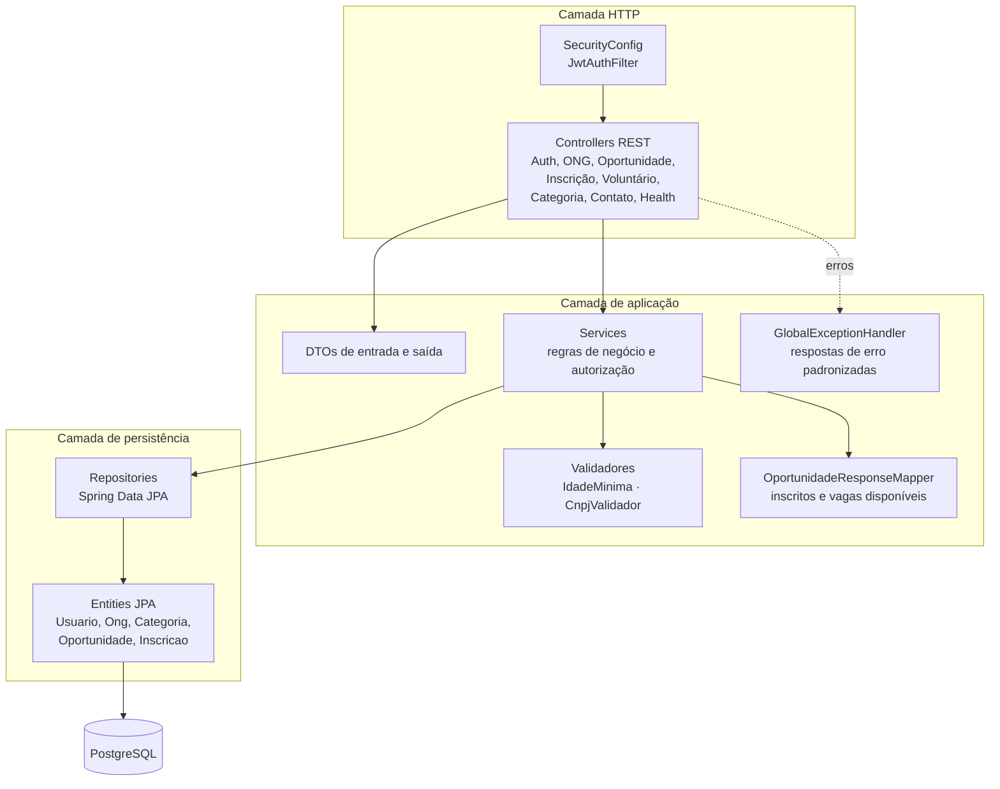
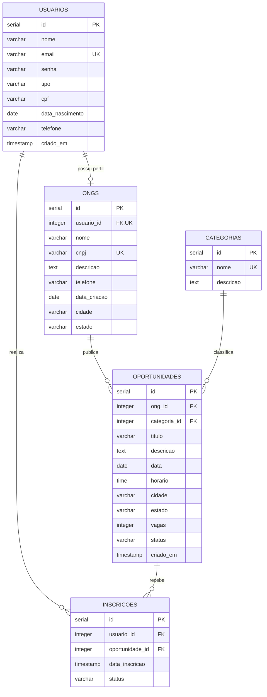
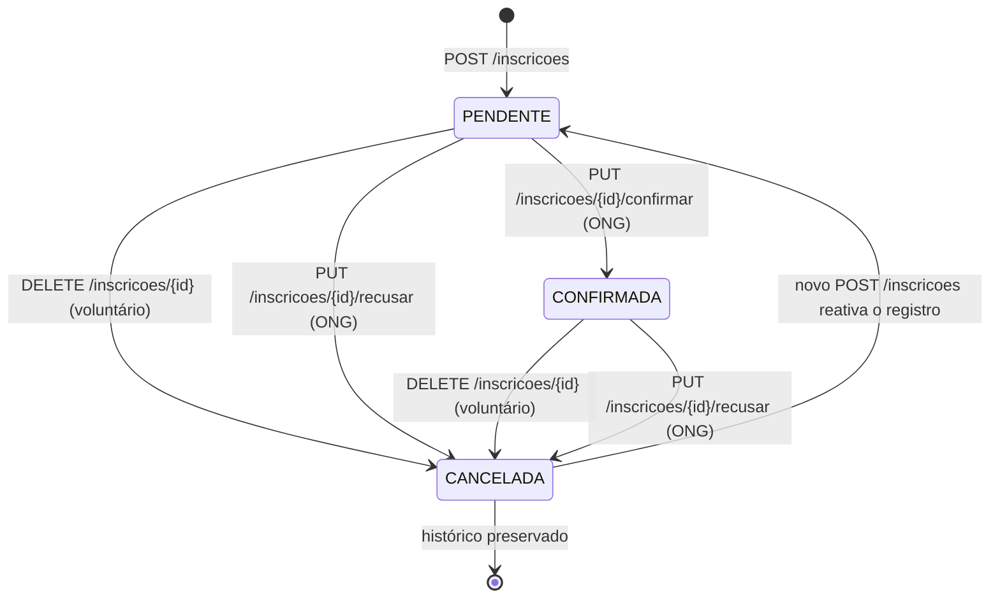
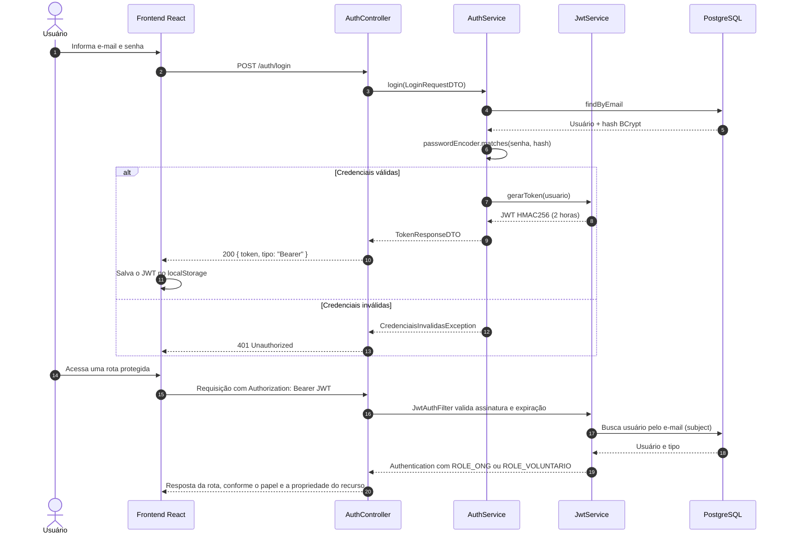

# 🛠️ Backend — Conecte-Bem

Documentação técnica da API REST do **Conecte-Bem**, construída com **Java 21**, **Spring Boot 4.1.1**, **Spring Security**, **Spring Data JPA** e **PostgreSQL**.

> Documentação geral do projeto: [README principal](../README.md) · Frontend: [frontend/README.md](../frontend/README.md) · Central de docs: [docs/README.md](../docs/README.md)

---

## Sumário

- [1. Apresentação](#1-apresentação)
- [2. Tecnologias utilizadas](#2-tecnologias-utilizadas)
- [3. Arquitetura do backend](#3-arquitetura-do-backend)
- [4. Organização das camadas](#4-organização-das-camadas)
- [5. Estrutura de pacotes](#5-estrutura-de-pacotes)
- [6. Modelagem do banco de dados](#6-modelagem-do-banco-de-dados)
- [7. Entidades e relacionamentos](#7-entidades-e-relacionamentos)
- [8. Configuração do PostgreSQL](#8-configuração-do-postgresql)
- [9. Variáveis de ambiente](#9-variáveis-de-ambiente)
- [10. Instalação](#10-instalação)
- [11. Execução da aplicação](#11-execução-da-aplicação)
- [12. Documentação dos endpoints](#12-documentação-dos-endpoints)
- [13. Métodos HTTP](#13-métodos-http)
- [14. Parâmetros de entrada](#14-parâmetros-de-entrada)
- [15. Exemplos de requisições](#15-exemplos-de-requisições)
- [16. Exemplos de respostas](#16-exemplos-de-respostas)
- [17. Códigos de resposta HTTP](#17-códigos-de-resposta-http)
- [18. Tratamento de erros](#18-tratamento-de-erros)
- [19. Autenticação e autorização](#19-autenticação-e-autorização)
- [20. Regras de negócio](#20-regras-de-negócio)
- [21. Testes automatizados com JUnit](#21-testes-automatizados-com-junit)
- [22. Como executar os testes](#22-como-executar-os-testes)
- [23. Considerações técnicas](#23-considerações-técnicas)
- [24. Referências internas](#24-referências-internas)

---

## 1. Apresentação

O backend do Conecte-Bem é uma API REST responsável por:

- cadastro e autenticação de **voluntários** e **ONGs**;
- emissão e validação de **JWT**;
- manutenção de perfis de voluntário e de ONG;
- publicação e gestão de **oportunidades de voluntariado**;
- candidaturas de voluntários e gestão de **inscritos** pelas ONGs;
- cálculo de indicadores do painel da ONG;
- consulta pública de oportunidades e categorias;
- envio de mensagens do formulário de contato por e-mail;
- padronização de erros e validações.

A aplicação é **stateless**: não há sessão no servidor. Cada requisição protegida é autenticada pelo cabeçalho `Authorization: Bearer <token>`.

---

## 2. Tecnologias utilizadas

| Tecnologia | Versão | Onde é usada |
|---|---|---|
| Java | 21 | Linguagem e runtime (`java.version` no `pom.xml`) |
| Spring Boot | 4.1.1 | Base da aplicação |
| Spring Web MVC | Gerenciado pelo Boot | Controllers REST |
| Spring Data JPA / Hibernate | Gerenciado pelo Boot | Repositórios e mapeamento ORM |
| Spring Security | Gerenciado pelo Boot | Autenticação e autorização |
| java-jwt (Auth0) | 4.5.0 | Assinatura e verificação do JWT |
| Bean Validation | Gerenciado pelo Boot | Validação dos DTOs |
| Spring Mail | Gerenciado pelo Boot | Envio de e-mail do contato |
| Google API Client | 2.7.2 | Validação do `idToken` do Google |
| PostgreSQL Driver | Gerenciado pelo Boot | Conexão com PostgreSQL |
| Lombok | Gerenciado pelo Boot | Redução de boilerplate |
| H2 | Gerenciado pelo Boot | Banco em memória nos testes |
| JUnit / Spring Boot Test | Gerenciado pelo Boot | Testes automatizados |
| Maven Wrapper | Incluído | Build e execução |

**Não utilizados:** Flyway, Liquibase, MapStruct, Swagger/OpenAPI, Redis, mensageria e cache distribuído.

---

## 3. Arquitetura do backend

O backend segue uma arquitetura em camadas, com separação entre HTTP, aplicação e persistência.



**Princípios aplicados:**

- Controllers recebem e devolvem DTOs, sem regra de negócio complexa.
- Services concentram validações, autorização de propriedade e transações.
- Repositories usam Spring Data JPA, com consultas derivadas e JPQL quando necessário.
- Entidades JPA não são serializadas diretamente na API.
- Exceções de domínio são convertidas em respostas HTTP padronizadas.
- A segurança é aplicada em duas camadas: papel na rota e propriedade do recurso no serviço.

---

## 4. Organização das camadas

| Camada | Pacote | Responsabilidade |
|---|---|---|
| **Configuração** | `config` | `SecurityConfig`, CORS, filtros, `PasswordEncoder` e `AuthenticationManager`. |
| **Segurança** | `security` | `JwtService`, `JwtAuthFilter` e `GoogleTokenService`. |
| **HTTP** | `controller` | Definição de rotas, verbos, status e entrada/saída. |
| **Contrato** | `dto` | Records e classes de requisição/resposta com validações. |
| **Aplicação** | `service` | Regras de negócio, transações, autorização e conversão para DTO. |
| **Persistência** | `repository` | Interfaces `JpaRepository` e consultas customizadas. |
| **Domínio** | `model` | Entidades JPA e enums (`TipoUsuario`, `StatusInscricao`). |
| **Erros** | `exception` | Exceções específicas e `GlobalExceptionHandler`. |

### Fluxo de uma requisição

```text
Requisição HTTP
  → JwtAuthFilter (quando há token)
  → Controller
  → DTO (@Valid)
  → Service (regras + autorização)
  → Repository
  → PostgreSQL
  → DTO de resposta
  → JSON
```

Falhas em qualquer etapa são tratadas pelo `GlobalExceptionHandler` ou pelos handlers de segurança.

---

## 5. Estrutura de pacotes

```text
backend/src/main/java/com/conectebem/backend/
├── BackendApplication.java
├── config/
│   └── SecurityConfig.java
├── controller/
│   ├── AuthController.java
│   ├── CategoriaController.java
│   ├── ContatoController.java
│   ├── HealthController.java
│   ├── InscricaoController.java
│   ├── OngController.java
│   ├── OportunidadeController.java
│   └── VoluntarioController.java
├── dto/
│   ├── CategoriaRequest.java / CategoriaResponse.java
│   ├── ContatoRequestDTO.java
│   ├── GoogleLoginRequestDTO.java
│   ├── InscricaoRequestDTO.java / InscricaoResponseDTO.java
│   ├── InscritoResponseDTO.java
│   ├── LoginRequestDTO.java / TokenResponseDTO.java
│   ├── OngPerfilRequestDTO.java
│   ├── OngRequestDTO.java / OngResponseDTO.java
│   ├── OportunidadeRequestDTO.java / OportunidadeResponseDTO.java
│   ├── PainelOngResponseDTO.java
│   ├── RegistroRequestDTO.java
│   ├── UsuarioResponseDTO.java
│   └── VoluntarioPerfilRequestDTO.java / VoluntarioPerfilResponseDTO.java
├── exception/
│   ├── CategoriaEmUsoException.java
│   ├── ContatoEnvioException.java
│   ├── CredenciaisInvalidasException.java
│   ├── GlobalExceptionHandler.java
│   ├── InscricaoConflictException.java
│   └── ResourceNotFoundException.java
├── model/
│   ├── Categoria.java
│   ├── Inscricao.java
│   ├── Ong.java
│   ├── Oportunidade.java
│   ├── StatusInscricao.java
│   ├── TipoUsuario.java
│   └── Usuario.java
├── repository/
│   ├── CategoriaRepository.java
│   ├── InscricaoRepository.java
│   ├── OngRepository.java
│   ├── OportunidadeRepository.java
│   └── UsuarioRepository.java
├── security/
│   ├── GoogleTokenService.java
│   ├── JwtAuthFilter.java
│   └── JwtService.java
└── service/
    ├── AuthService.java
    ├── CategoriaService.java
    ├── CnpjValidador.java
    ├── ContatoService.java
    ├── IdadeMinima.java
    ├── InscricaoService.java
    ├── OngService.java
    ├── OportunidadeResponseMapper.java
    ├── OportunidadeService.java
    └── VoluntarioService.java
```

Arquivos de apoio:

```text
backend/
├── db/schema.sql
├── db/migrations/20261110_qa009_dados_cadastro.sql
├── src/main/resources/application.properties
├── src/test/resources/application.properties
├── docker-compose.yml
├── pom.xml
├── mvnw / mvnw.cmd
└── README.md
```

---

## 6. Modelagem do banco de dados

O schema oficial está em [`db/schema.sql`](db/schema.sql). O projeto usa PostgreSQL e `spring.jpa.hibernate.ddl-auto=validate`, portanto o banco deve ser criado/atualizado **manualmente**.



### 6.1 Tabela `usuarios`

| Coluna | Tipo | Restrições |
|---|---|---|
| `id` | `SERIAL` | PK |
| `nome` | `varchar(150)` | NOT NULL |
| `email` | `varchar(150)` | NOT NULL, UNIQUE |
| `senha` | `varchar(255)` | NOT NULL, hash BCrypt |
| `tipo` | `varchar(20)` | NOT NULL, CHECK `VOLUNTARIO`, `ONG`, `ADMIN` |
| `cpf` | `varchar(11)` | Anulável, somente dígitos |
| `data_nascimento` | `date` | Anulável no banco; obrigatória para novos voluntários na API |
| `telefone` | `varchar(20)` | Anulável |
| `criado_em` | `timestamp` | NOT NULL, default `now()` |

### 6.2 Tabela `ongs`

| Coluna | Tipo | Restrições |
|---|---|---|
| `id` | `SERIAL` | PK |
| `usuario_id` | `integer` | NOT NULL, UNIQUE, FK → `usuarios(id)` `ON DELETE CASCADE` |
| `nome` | `varchar(150)` | NOT NULL |
| `cnpj` | `varchar(18)` | NOT NULL, UNIQUE |
| `descricao` | `text` | Anulável |
| `telefone` | `varchar(20)` | Anulável |
| `data_criacao` | `date` | Anulável |
| `cidade` | `varchar(100)` | Anulável |
| `estado` | `varchar(2)` | Anulável |

### 6.3 Tabela `categorias`

| Coluna | Tipo | Restrições |
|---|---|---|
| `id` | `SERIAL` | PK |
| `nome` | `varchar(100)` | NOT NULL, UNIQUE |
| `descricao` | `text` | Anulável no schema |

### 6.4 Tabela `oportunidades`

| Coluna | Tipo | Restrições |
|---|---|---|
| `id` | `SERIAL` | PK |
| `ong_id` | `integer` | NOT NULL, FK → `ongs(id)` `ON DELETE CASCADE` |
| `categoria_id` | `integer` | NOT NULL, FK → `categorias(id)` `ON DELETE RESTRICT` |
| `titulo` | `varchar(150)` | NOT NULL |
| `descricao` | `text` | Anulável |
| `data` | `date` | NOT NULL |
| `horario` | `time(0)` | Anulável no schema |
| `cidade` | `varchar(100)` | Anulável |
| `estado` | `varchar(2)` | Anulável |
| `vagas` | `integer` | NOT NULL, CHECK `vagas >= 0` |
| `status` | `varchar(20)` | NOT NULL, default `ABERTA`, CHECK `ABERTA`, `ENCERRADA`, `CANCELADA` |
| `criado_em` | `timestamp(6)` | NOT NULL, default `now()` |

### 6.5 Tabela `inscricoes`

| Coluna | Tipo | Restrições |
|---|---|---|
| `id` | `SERIAL` | PK |
| `usuario_id` | `integer` | NOT NULL, FK → `usuarios(id)` `ON DELETE CASCADE` |
| `oportunidade_id` | `integer` | NOT NULL, FK → `oportunidades(id)` `ON DELETE CASCADE` |
| `data_inscricao` | `timestamp` | NOT NULL, default `now()` |
| `status` | `varchar(20)` | NOT NULL, default `PENDENTE`, CHECK `PENDENTE`, `CONFIRMADA`, `CANCELADA` |

**Restrição de unicidade:** `uq_inscricao_usuario_oportunidade (usuario_id, oportunidade_id)`.

### 6.6 Índices

```sql
CREATE INDEX idx_inscricoes_status           ON inscricoes    (status);
CREATE INDEX idx_oportunidades_cidade_estado ON oportunidades (cidade, estado);
CREATE INDEX idx_oportunidades_status        ON oportunidades (status);
```

### 6.7 Migração existente

| Arquivo | Finalidade |
|---|---|
| `db/schema.sql` | Instalação em base vazia, já com os campos do QA-009. |
| `db/migrations/20261110_qa009_dados_cadastro.sql` | Atualização de base existente: `usuarios.cpf`, `usuarios.data_nascimento`, `usuarios.telefone` e `ongs.data_criacao`. |

A migração usa `ADD COLUMN IF NOT EXISTS` e mantém os campos anuláveis para compatibilidade com contas antigas.

---

## 7. Entidades e relacionamentos

| Entidade | Tabela | Relacionamentos |
|---|---|---|
| `Usuario` | `usuarios` | Não possui coleção JPA; é referenciado por `Inscricao.usuario`. O vínculo com ONG é feito por `Ong.usuarioId` (inteiro). |
| `Ong` | `ongs` | `usuarioId` único (1 usuário → 0..1 ONG). Possui várias `Oportunidade` pela FK `oportunidades.ong_id`. |
| `Categoria` | `categorias` | Possui várias `Oportunidade`. |
| `Oportunidade` | `oportunidades` | `@ManyToOne` para `Ong` e `Categoria`; recebe várias `Inscricao`. |
| `Inscricao` | `inscricoes` | `@ManyToOne` (LAZY) para `Usuario` e `Oportunidade`. |

### Regras de relacionamento

- **Usuário → ONG:** 1:0..1. A unicidade de `ongs.usuario_id` impede duas ONGs para o mesmo usuário.
- **ONG → Oportunidade:** 1:N. Apagar uma ONG remove suas oportunidades por `ON DELETE CASCADE`.
- **Categoria → Oportunidade:** 1:N. Apagar uma categoria em uso é bloqueado por `ON DELETE RESTRICT` e convertido em HTTP 409.
- **Usuário → Inscrição:** 1:N. Apagar um usuário remove suas inscrições.
- **Oportunidade → Inscrição:** 1:N. Apagar uma oportunidade remove suas inscrições.

### Enums

```java
public enum TipoUsuario { VOLUNTARIO, ONG }

public enum StatusInscricao { PENDENTE, CONFIRMADA, CANCELADA }
```

`StatusInscricao` é persistido como texto (`EnumType.STRING`). `PENDENTE` e `CONFIRMADA` ocupam vaga; `CANCELADA` não ocupa.

---

## 8. Configuração do PostgreSQL

### 8.1 Configuração da aplicação

```properties
spring.datasource.url=${DB_URL:jdbc:postgresql://localhost:5432/conect-bem-db}
spring.datasource.username=${DB_USERNAME:postgres}
spring.datasource.password=${DB_PASSWORD}
spring.datasource.driver-class-name=org.postgresql.Driver

spring.jpa.hibernate.ddl-auto=validate
spring.jpa.properties.hibernate.dialect=org.hibernate.dialect.PostgreSQLDialect
```

- `ddl-auto=validate`: o Hibernate **valida** o schema, mas não cria nem altera tabelas.
- `DB_PASSWORD` não possui valor padrão e é obrigatória.
- O banco padrão é `conect-bem-db` em `localhost:5432`.

### 8.2 Docker Compose

O arquivo [`docker-compose.yml`](docker-compose.yml) sobe **PostgreSQL 16** e **pgAdmin 4**. Ele não sobe o backend.

```bash
cd backend
docker compose up -d
```

Variáveis usadas pelo Compose:

| Variável | Padrão | Observação |
|---|---|---|
| `DB_USERNAME` | `postgres` | Usuário do banco. |
| `DB_PASSWORD` | — | Obrigatória; o Compose interrompe se não existir. |
| `DB_NAME` | `conect-bem-db` | Nome do banco criado. |

Crie `backend/.env` (ignorado pelo Git) antes de executar. O pgAdmin fica em `http://localhost:5050`; as credenciais estão definidas no próprio `docker-compose.yml`.

### 8.3 PostgreSQL local

1. Crie o banco `conect-bem-db`.
2. Em base vazia:

```bash
psql -U postgres -d conect-bem-db -f backend/db/schema.sql
```

3. Em base existente:

```bash
psql -U postgres -d conect-bem-db -f backend/db/migrations/20261110_qa009_dados_cadastro.sql
```

### 8.4 Banco de testes

Os testes usam H2 em memória, configurado em `src/test/resources/application.properties`:

```properties
spring.datasource.url=jdbc:h2:mem:testdb
spring.jpa.hibernate.ddl-auto=create-drop
```

Assim, a suíte não depende do PostgreSQL local, de SMTP real ou de credenciais do Google.

---

## 9. Variáveis de ambiente

O `application.properties` importa automaticamente:

```properties
spring.config.import=optional:file:./backend/.env.local[.properties],optional:file:./.env.local[.properties]
```

| Variável | Obrigatória | Padrão | Uso |
|---|---|---|---|
| `DB_URL` | Não | `jdbc:postgresql://localhost:5432/conect-bem-db` | URL JDBC. |
| `DB_USERNAME` | Não | `postgres` | Usuário do banco. |
| `DB_PASSWORD` | **Sim** | — | Senha do banco. |
| `JWT_SECRET` | **Sim** | — | Segredo HMAC256, mínimo de 32 caracteres. |
| `GOOGLE_CLIENT_ID` | Não | Valor padrão em `application.properties` | Client ID usado na validação do `idToken`. Para produção, defina explicitamente. |
| `MAIL_HOST` | Não | `sandbox.smtp.mailtrap.io` | Host SMTP. |
| `MAIL_PORT` | Não | `2525` | Porta SMTP. |
| `MAIL_USERNAME` | **Sim** | — | Usuário SMTP. |
| `MAIL_PASSWORD` | **Sim** | — | Senha SMTP. |
| `CONTATO_EMAIL_DESTINO` | Não | Destinatário definido em `application.properties` | Destino das mensagens do formulário. |

Propriedade adicional lida por `ContatoService`:

- `contato.email.remetente` — remetente do e-mail; padrão `contato@conectebem.local`.

> **Segurança:** nunca versionar `.env`, `.env.local` ou credenciais reais. O `JWT_SECRET` deve ser aleatório e exclusivo por ambiente. Alterar o segredo invalida todos os tokens emitidos anteriormente.

---

## 10. Instalação

### 10.1 Pré-requisitos

- Java 21.
- `JAVA_HOME` apontando para o JDK 21 usado pelo Maven Wrapper.
- PostgreSQL 16 (ou Docker + Docker Compose).
- Git.
- Acesso à internet para o Maven baixar dependências na primeira execução.

> **Importante:** o build usa Lombok, que pode falhar em versões muito novas do JDK. Durante a validação deste documento, com `JAVA_HOME` apontando para o JDK 27, o comando `.\mvnw.cmd test` terminou com `ExceptionInInitializerError: com.sun.tools.javac.tree.EndPosTable`. Com o JDK 21, os 127 testes passaram. Ajuste `JAVA_HOME` antes de compilar ou executar os testes.

### 10.2 Clonar e preparar

```bash
git clone https://github.com/julianorafael-dev/conecte-bem.git
cd conecte-bem/backend
```

Crie `backend/.env.local` com as variáveis locais. Exemplo com placeholders:

```properties
DB_URL=jdbc:postgresql://localhost:5432/conect-bem-db
DB_USERNAME=postgres
DB_PASSWORD=troque-por-sua-senha-local
JWT_SECRET=uma-chave-aleatoria-com-pelo-menos-32-caracteres
MAIL_USERNAME=usuario-do-provedor-smtp
MAIL_PASSWORD=senha-do-provedor-smtp
CONTATO_EMAIL_DESTINO=destino@exemplo.com
```

### 10.3 Preparar o banco

Siga a seção [Configuração do PostgreSQL](#8-configuração-do-postgresql).

### 10.4 Build

```bash
# Windows
.\mvnw.cmd clean package

# Linux / macOS
./mvnw clean package
```

O artefato é gerado em `target/`.

---

## 11. Execução da aplicação

```bash
cd backend

# Windows
.\mvnw.cmd spring-boot:run

# Linux / macOS
./mvnw spring-boot:run
```

A API inicia em **`http://localhost:8080`**.

### Verificação

```bash
curl http://localhost:8080/health
# ok
```

### Executar o JAR

```bash
java -jar target/backend-0.0.1-SNAPSHOT.jar
```

> O JAR depende das mesmas variáveis de ambiente do modo `spring-boot:run`.

### Perfis e configuração

O projeto possui apenas o `application.properties` principal e o `application.properties` de testes. Não há perfis `dev`, `prod` ou `application-*.properties` configurados.

---

## 12. Documentação dos endpoints

### 12.1 Convenções

- Base local: `http://localhost:8080`.
- Formato: **JSON** (`Content-Type: application/json`).
- Autenticação: `Authorization: Bearer <JWT>`.
- Datas: `YYYY-MM-DD`.
- Horários: `HH:mm` ou `HH:mm:ss`.
- Datas/horas de criação: ISO-8601 (`YYYY-MM-DDTHH:mm:ss`).
- IDs são inteiros.
- `GET /oportunidades` é paginado: `page` (padrão `0`) e `size` (padrão `100`, máximo `100`), com o total no cabeçalho `X-Total-Count`. As demais listagens retornam todos os registros compatíveis com o filtro.

### 12.2 Resumo quantitativo

| Módulo | Endpoints | Disponibilidade atual |
|---|---:|---|
| Autenticação | 3 | Públicos |
| ONGs | 8 | 7 públicos/protegidos + `POST /ongs` bloqueado por `denyAll` |
| Oportunidades | 5 | 2 públicos + 3 restritos a ONG |
| Inscrições | 6 | 3 de voluntário + 3 de ONG |
| Voluntários | 2 | Restritos a voluntário |
| Categorias | 5 | 2 públicos + 3 bloqueados por `denyAll` |
| Contato | 1 | Público |
| Health | 1 | Público |
| **Total** | **31** | **27 utilizáveis + 4 bloqueados** |

> **Administração:** não existe controller, papel ou fluxo administrativo implementado. O módulo “Administração” não é documentado como funcionalidade pronta.

---

## 12.3 Módulo Autenticação

### `POST /auth/registro`

**Descrição:** cria uma conta de voluntário ou de ONG. Para ONGs, o registro em `ongs` é criado na mesma transação.

**Permissão:** pública.

**Corpo da requisição:**

| Campo | Tipo | Obrigatório | Regras |
|---|---|---|---|
| `nome` | string | Sim | Máximo 150 caracteres. Para ONG, vira o nome da ONG. |
| `email` | string | Sim | E-mail válido, máximo 150, único. |
| `senha` | string | Sim | Mínimo 6 caracteres; armazenada com BCrypt. |
| `tipo` | enum | Sim | `VOLUNTARIO` ou `ONG`. |
| `cpf` | string | Não | CPF válido, máximo 14; persistido somente com dígitos. |
| `dataNascimento` | date | Condicional | Obrigatória para `VOLUNTARIO`; não pode ser futura; idade mínima de 18 anos. |
| `dataCriacao` | date | Não | Data de criação da ONG; não pode ser futura. |
| `cnpj` | string | Condicional | Obrigatório para `ONG`; validado e normalizado para 14 dígitos. |
| `descricao` | string | Não | Descrição da ONG. |
| `telefone` | string | Não | Máximo 20 caracteres. |
| `cidade` | string | Não | Máximo 100 caracteres. |
| `estado` | string | Não | UF com duas letras; normalizada para maiúsculas. |

**Exemplo — voluntário:**

```json
{
  "nome": "Ana Souza",
  "email": "ana.souza@exemplo.com",
  "senha": "senhaSegura123",
  "tipo": "VOLUNTARIO",
  "cpf": "52998224725",
  "dataNascimento": "1998-05-20",
  "telefone": "51999999999"
}
```

**Resposta `201 Created`:**

```json
{
  "id": 1,
  "nome": "Ana Souza",
  "email": "ana.souza@exemplo.com",
  "tipo": "VOLUNTARIO"
}
```

**Exemplo — ONG:**

```json
{
  "nome": "ONG Esperança",
  "email": "contato@ongesperanca.org",
  "senha": "senhaSegura123",
  "tipo": "ONG",
  "cnpj": "11222333000181",
  "dataCriacao": "2015-03-10",
  "descricao": "Projetos de educação e assistência social.",
  "telefone": "5133334444",
  "cidade": "Porto Alegre",
  "estado": "RS"
}
```

**Erros:**

| Status | Situação |
|---|---|
| `400` | Validação de campo, e-mail já cadastrado, CNPJ inválido/já cadastrado, idade mínima, UF inválida ou data futura. |
| `409` | Conflito de unicidade detectado pelo banco. |
| `500` | Erro inesperado. |

> O CPF é opcional no DTO. A data de nascimento também é opcional no DTO, mas o `AuthService` rejeita voluntário sem ela.

---

### `POST /auth/login`

**Descrição:** autentica por e-mail e senha e retorna um JWT.

**Permissão:** pública.

**Corpo:**

| Campo | Tipo | Obrigatório |
|---|---|---|
| `email` | string | Sim |
| `senha` | string | Sim |

```json
{
  "email": "ana.souza@exemplo.com",
  "senha": "senhaSegura123"
}
```

**Resposta `200 OK`:**

```json
{
  "token": "<jwt>",
  "tipo": "Bearer"
}
```

**Erros:** `400` para corpo inválido; `401` para e-mail ou senha incorretos.

---

### `POST /auth/google`

**Descrição:** valida um `idToken` do Google e emite um JWT do Conecte-Bem para uma conta **já existente**.

**Permissão:** pública.

**Corpo:**

```json
{
  "idToken": "<google-id-token>"
}
```

**Resposta `200 OK`:**

```json
{
  "token": "<jwt>",
  "tipo": "Bearer"
}
```

**Erros:**

| Status | Situação |
|---|---|
| `400` | Token Google inválido/expirado ou e-mail sem conta cadastrada. |

> O login Google **não cria conta** e **não coleta data de nascimento**. A mensagem orienta o usuário a usar o formulário de cadastro.

---

## 12.4 Módulo ONGs

### `GET /ongs`

**Descrição:** lista todas as ONGs cadastradas.

**Permissão:** pública.

**Resposta `200 OK`:**

```json
[
  {
    "id": 1,
    "nome": "ONG Esperança",
    "cnpj": "11222333000181",
    "descricao": "Projetos de educação e assistência social.",
    "telefone": "5133334444",
    "cidade": "Porto Alegre",
    "estado": "RS",
    "dataCriacao": "2015-03-10"
  }
]
```

---

### `GET /ongs/{id}`

**Descrição:** busca uma ONG pelo ID.

**Permissão:** pública.

**Parâmetro de rota:** `id` (integer).

**Resposta `200 OK`:** objeto `OngResponseDTO` no formato acima.

**Erros:** `404` quando a ONG não existe; `400` quando o ID não é inteiro.

---

### `GET /ongs/me`

**Descrição:** retorna o perfil da ONG vinculada ao usuário autenticado.

**Permissão:** `ROLE_ONG`.

**Resposta `200 OK`:** objeto `OngResponseDTO`.

**Erros:** `401` sem token; `403` para voluntário; `404` se a conta ONG não tiver registro em `ongs`.

---

### `GET /ongs/me/painel`

**Descrição:** retorna os indicadores do painel da ONG autenticada.

**Permissão:** `ROLE_ONG`.

**Resposta `200 OK`:**

```json
{
  "nomeOng": "ONG Esperança",
  "totalOportunidades": 8,
  "oportunidadesAtivas": 5,
  "oportunidadesEncerradas": 2,
  "totalVoluntariosInscritos": 24
}
```

**Regras dos indicadores:**

- `totalOportunidades`: todas as oportunidades da ONG.
- `oportunidadesAtivas`: status `ABERTA`.
- `oportunidadesEncerradas`: status `ENCERRADA`.
- `totalVoluntariosInscritos`: inscrições `PENDENTE` ou `CONFIRMADA` nas oportunidades da ONG.

**Erros:** `401`, `403`, `404`.

---

### `GET /ongs/me/oportunidades`

**Descrição:** lista as oportunidades da ONG autenticada, em ordem decrescente de criação.

**Permissão:** `ROLE_ONG`.

**Resposta `200 OK`:** lista de `OportunidadeResponseDTO` (formato na seção de oportunidades).

**Erros:** `401`, `403`, `404`.

---

### `PUT /ongs/me`

**Descrição:** atualiza o perfil da ONG autenticada. O CNPJ e o vínculo com o usuário não são alterados.

**Permissão:** `ROLE_ONG`.

**Corpo:**

| Campo | Tipo | Obrigatório | Regras |
|---|---|---|---|
| `nome` | string | Sim | Máximo 150. |
| `descricao` | string | Não | — |
| `telefone` | string | Não | Máximo 20. |
| `cidade` | string | Não | Máximo 100. |
| `estado` | string | Não | Duas letras maiúsculas. |

```json
{
  "nome": "ONG Esperança",
  "descricao": "Atuamos em educação e assistência social desde 2015.",
  "telefone": "5133334444",
  "cidade": "Porto Alegre",
  "estado": "RS"
}
```

**Resposta `200 OK`:** `OngResponseDTO` atualizado.

**Erros:** `400`, `401`, `403`, `404`.

---

### `POST /ongs`

**Descrição:** cadastro legado de ONG vinculada a um usuário existente. A rota permanece no controller, mas está **bloqueada por `denyAll`** no `SecurityConfig`.

**Permissão:** **bloqueada** (`denyAll`). Visitante recebe `401`; usuário autenticado recebe `403`. O cadastro de ONG é feito por `POST /auth/registro`.

**Corpo:**

| Campo | Tipo | Obrigatório | Regras |
|---|---|---|---|
| `usuarioId` | integer | Sim | Deve existir em `usuarios`. |
| `nome` | string | Sim | Máximo 150. |
| `cnpj` | string | Sim | Máximo 18; unicidade garantida pelo banco. |
| `descricao` | string | Não | — |
| `telefone` | string | Não | Máximo 20. |
| `cidade` | string | Não | Máximo 100. |
| `estado` | string | Não | Duas letras maiúsculas. |

```json
{
  "usuarioId": 10,
  "nome": "ONG Esperança",
  "cnpj": "11222333000181",
  "descricao": "Projetos de educação e assistência social.",
  "telefone": "5133334444",
  "cidade": "Porto Alegre",
  "estado": "RS"
}
```

**Resposta esperada no controller:** `201 Created` (inalcançável pela API).

**Resposta efetiva:** `401` para visitante / `403` para autenticado.

> **⚠️ Atenção:** o cadastro de ONG no fluxo principal é feito por `POST /auth/registro`, que cria a conta e o perfil na mesma transação. A rota `POST /ongs` foi mantida apenas por compatibilidade histórica e está fechada para todos os perfis. Ver [Considerações técnicas](#23-considerações-técnicas).

---

### `PUT /ongs/{id}`

**Descrição:** atualiza uma ONG existente. O `usuarioId` do corpo é ignorado; o vínculo não é transferido.

**Permissão:** `ROLE_ONG` + propriedade da ONG (validada no serviço).

**Parâmetro de rota:** `id`.

**Corpo:** mesmo formato de `OngRequestDTO` (`usuarioId`, `nome`, `cnpj`, etc.).

**Resposta `200 OK`:** `OngResponseDTO`.

**Erros:** `400` validação (incluindo CNPJ inválido); `401`; `403` para outra ONG/voluntário; `404`; `409` para CNPJ já usado por outra ONG.

---

## 12.5 Módulo Oportunidades

### `GET /oportunidades`

**Descrição:** lista oportunidades de forma paginada. Sem filtros, retorna a primeira página (até 100 registros). O corpo continua sendo uma lista JSON; o total de registros vem no cabeçalho `X-Total-Count`.

**Permissão:** pública.

**Parâmetros de query:**

| Parâmetro | Tipo | Obrigatório | Comportamento |
|---|---|---|---|
| `cidade` | string | Não | Filtra por cidade exata. |
| `categoria` | integer | Não | Filtra pelo ID da categoria. |
| `status` | string | Não | `ABERTA`, `ENCERRADA` ou `CANCELADA`. |
| `page` | integer | Não | Página, começando em `0` (padrão `0`). Valores negativos são tratados como `0`. |
| `size` | integer | Não | Tamanho da página (padrão `100`, máximo `100`). Valores menores que `1` são tratados como `1`. |

> **📌 Paginação:** os resultados são ordenados por `id`. O cabeçalho `X-Total-Count` informa o total de registros compatíveis com o filtro, independentemente da página retornada.

**Regra de combinação:** o controller aplica **apenas um filtro por vez**. Se mais de um parâmetro for enviado, a API retorna todas as oportunidades, sem combinar filtros. Essa limitação está registrada no próprio código.

**Exemplo:**

```http
GET /oportunidades?status=ABERTA&page=0&size=20
```

**Resposta `200 OK`** (com `X-Total-Count` indicando o total):

```json
[
  {
    "id": 12,
    "ongId": 3,
    "nomeOng": "ONG Esperança",
    "categoriaId": 2,
    "nomeCategoria": "Educação",
    "titulo": "Reforço escolar para crianças",
    "descricao": "Apoio em matemática e português para crianças do ensino fundamental.",
    "data": "2026-12-05",
    "horario": "14:00:00",
    "cidade": "Porto Alegre",
    "estado": "RS",
    "vagas": 10,
    "status": "ABERTA",
    "criadoEm": "2026-11-11T10:30:00",
    "inscritos": 4,
    "vagasDisponiveis": 6
  }
]
```

**Erros:** `400` para `status` inválido ou `categoria` não numérica; `404` quando a categoria informada não existe.

---

### `GET /oportunidades/{id}`

**Descrição:** busca uma oportunidade pelo ID.

**Permissão:** pública.

**Resposta `200 OK`:** um `OportunidadeResponseDTO`.

**Erros:** `400` para ID inválido; `404` para oportunidade inexistente.

---

### `POST /oportunidades`

**Descrição:** cria uma oportunidade vinculada à ONG do usuário autenticado.

**Permissão:** `ROLE_ONG`.

**Corpo:**

| Campo | Tipo | Obrigatório | Regras |
|---|---|---|---|
| `ongId` | integer | Sim | Obrigatório no contrato, mas **ignorado para definir o proprietário**; a ONG vem do token. |
| `categoriaId` | integer | Sim | Deve existir. |
| `titulo` | string | Sim | Máximo 150. |
| `descricao` | string | Não | — |
| `data` | date | Sim | `YYYY-MM-DD`. |
| `horario` | time | Sim | `HH:mm` ou `HH:mm:ss`. |
| `cidade` | string | Não | Máximo 100. |
| `estado` | string | Não | Duas letras maiúsculas. |
| `vagas` | integer | Sim | Mínimo 1. |
| `status` | string | Sim | `ABERTA`, `ENCERRADA` ou `CANCELADA`. |

```json
{
  "ongId": 3,
  "categoriaId": 2,
  "titulo": "Reforço escolar para crianças",
  "descricao": "Apoio em matemática e português para crianças do ensino fundamental.",
  "data": "2026-12-05",
  "horario": "14:00",
  "cidade": "Porto Alegre",
  "estado": "RS",
  "vagas": 10,
  "status": "ABERTA"
}
```

**Resposta `201 Created`:** `OportunidadeResponseDTO`.

**Erros:**

| Status | Situação |
|---|---|
| `400` | Validação, status inválido, categoria não numérica ou oportunidade `ABERTA` com data no passado. |
| `401` | Sem token. |
| `403` | Conta que não é ONG. |
| `404` | Conta ONG sem registro de ONG ou categoria inexistente. |

---

### `PUT /oportunidades/{id}`

**Descrição:** atualiza uma oportunidade da ONG autenticada.

**Permissão:** `ROLE_ONG` + propriedade.

**Corpo:** mesmo `OportunidadeRequestDTO` da criação.

**Resposta `200 OK`:** `OportunidadeResponseDTO` atualizado.

**Regras adicionais:**

- A ONG proprietária não pode ser alterada.
- `criadoEm` e `id` não são alterados.
- A linha é bloqueada com `PESSIMISTIC_WRITE` durante a validação de capacidade.
- Não é possível reduzir `vagas` abaixo do número de inscrições ativas.
- Uma oportunidade `ABERTA` não pode ser publicada com data no passado; a regra é dispensada quando a oportunidade já estava `ABERTA` e mantém a mesma data.

**Erros:** `400` (incluindo data passada para status `ABERTA`); `401`; `403` para outra ONG; `404` para oportunidade/categoria inexistente; `409` ao reduzir vagas abaixo das inscrições ativas.

---

### `DELETE /oportunidades/{id}`

**Descrição:** cancela uma oportunidade da ONG autenticada. O registro não é apagado: o status passa para `CANCELADA`, preservando inscrições e histórico.

**Permissão:** `ROLE_ONG` + propriedade.

**Resposta `204 No Content`.**

**Erros:** `401`, `403`, `404`.

> **ℹ️ Exclusão lógica:** o `DELETE` cancela a oportunidade (`status = CANCELADA`) e usa bloqueio compartilhado com a inscrição (`findByIdForUpdate`) para serializar o cancelamento e novas candidaturas. O frontend usa `PUT /oportunidades/{id}` para o mesmo efeito.

---

## 12.6 Módulo Inscrições

### `POST /inscricoes`

**Descrição:** cria uma candidatura para o voluntário autenticado. Se já existir uma inscrição cancelada para a mesma oportunidade, ela é reativada.

**Permissão:** `ROLE_VOLUNTARIO`.

**Corpo:**

```json
{
  "oportunidadeId": 12
}
```

**Resposta `201 Created`:**

```json
{
  "id": 41,
  "oportunidadeId": 12,
  "tituloOportunidade": "Reforço escolar para crianças",
  "nomeOng": "ONG Esperança",
  "data": "2026-12-05",
  "horario": "14:00:00",
  "cidade": "Porto Alegre",
  "estado": "RS",
  "descricaoOportunidade": "Apoio em matemática e português para crianças do ensino fundamental.",
  "statusInscricao": "PENDENTE",
  "statusOportunidade": "ABERTA",
  "dataInscricao": "2026-11-11T14:30:00"
}
```

**Erros:**

| Status | Situação |
|---|---|
| `400` | `oportunidadeId` ausente/inválido. |
| `401` | Sem token. |
| `403` | Conta que não é voluntário. |
| `404` | Oportunidade inexistente. |
| `409` | Inscrição ativa duplicada, oportunidade não `ABERTA`, com data já passada ou sem vagas. |

**Regras:** a oportunidade é bloqueada com `PESSIMISTIC_WRITE` antes da contagem de vagas. Apenas `PENDENTE` e `CONFIRMADA` ocupam vaga. Inscrições em oportunidades cuja data já passou (fuso `America/Sao_Paulo`) são recusadas com `409`.

---

### `GET /inscricoes/me`

**Descrição:** lista as candidaturas do voluntário autenticado, das mais recentes para as mais antigas.

**Permissão:** `ROLE_VOLUNTARIO`.

**Resposta `200 OK`:** lista de `InscricaoResponseDTO` (mesmo formato acima). Sem candidaturas, retorna `[]`.

**Erros:** `401`, `403`.

---

### `DELETE /inscricoes/{id}`

**Descrição:** cancela uma inscrição do voluntário autenticado. O registro não é apagado; o status passa para `CANCELADA`.

**Permissão:** `ROLE_VOLUNTARIO` + propriedade da inscrição.

**Resposta `204 No Content`.**

**Erros:** `401`, `403` para inscrição de outra pessoa, `404` para inscrição inexistente.

---

### `PUT /inscricoes/{id}/confirmar`

**Descrição:** a ONG proprietária confirma uma inscrição `PENDENTE`.

**Permissão:** `ROLE_ONG` + propriedade da oportunidade.

**Resposta `200 OK`:**

```json
{
  "id": 41,
  "usuarioId": 7,
  "nomeVoluntario": "Ana Souza",
  "emailVoluntario": "ana.souza@exemplo.com",
  "status": "CONFIRMADA",
  "dataInscricao": "2026-11-11T14:30:00"
}
```

**Erros:** `401`; `403` para outra ONG; `404`; `409` ao tentar confirmar inscrição `CANCELADA`.

> Confirmar uma inscrição já confirmada é idempotente: retorna o registro sem alteração.

---

### `PUT /inscricoes/{id}/recusar`

**Descrição:** a ONG proprietária cancela uma inscrição `PENDENTE` ou `CONFIRMADA`, liberando a vaga.

**Permissão:** `ROLE_ONG` + propriedade.

**Resposta `200 OK`:** `InscritoResponseDTO` com `status: "CANCELADA"`.

**Erros:** `401`, `403`, `404`. Cancelar uma inscrição já cancelada é idempotente.

---

### `GET /oportunidades/{oportunidadeId}/inscricoes`

**Descrição:** lista os voluntários inscritos em uma oportunidade, incluindo inscrições canceladas para preservar o histórico.

**Permissão:** `ROLE_ONG` + propriedade da oportunidade.

**Resposta `200 OK`:**

```json
[
  {
    "id": 41,
    "usuarioId": 7,
    "nomeVoluntario": "Ana Souza",
    "emailVoluntario": "ana.souza@exemplo.com",
    "status": "PENDENTE",
    "dataInscricao": "2026-11-11T14:30:00"
  }
]
```

**Erros:** `401`, `403`, `404`.

> Esta regra específica aparece **antes** do `GET /oportunidades/**` público no `SecurityConfig`, para não expor nomes e e-mails de voluntários.

### Ciclo de vida da inscrição



---

## 12.7 Módulo Voluntários

### `GET /voluntarios/me`

**Descrição:** retorna os dados pessoais do voluntário autenticado.

**Permissão:** `ROLE_VOLUNTARIO`.

**Resposta `200 OK`:**

```json
{
  "id": 7,
  "nome": "Ana Souza",
  "email": "ana.souza@exemplo.com",
  "tipo": "VOLUNTARIO",
  "cpf": "52998224725",
  "dataNascimento": "1998-05-20",
  "telefone": "51999999999"
}
```

**Erros:** `401`, `403`, `404`.

---

### `PUT /voluntarios/me`

**Descrição:** atualiza o nome do voluntário autenticado. CPF, data de nascimento, e-mail e telefone são somente leitura nesta versão.

**Permissão:** `ROLE_VOLUNTARIO`.

**Corpo:**

```json
{
  "nome": "Ana Souza Lima"
}
```

**Resposta `200 OK`:** `VoluntarioPerfilResponseDTO` atualizado.

**Erros:** `400` para nome vazio ou maior que 150; `401`, `403`, `404`.

---

## 12.8 Módulo Categorias

> **Estado atual:** apenas as consultas estão disponíveis. As rotas de escrita estão implementadas no controller, mas o `SecurityConfig` aplica `denyAll` em `/categorias` e `/categorias/**` para todos os métodos não liberados anteriormente, pois ainda não existe perfil de administrador. Visitantes recebem `401`; usuários autenticados recebem `403`.

### `GET /categorias`

**Descrição:** lista todas as categorias.

**Permissão:** pública.

**Resposta `200 OK`:**

```json
[
  {
    "id": 1,
    "nome": "Educação",
    "descricao": "Ações de apoio escolar, reforço e alfabetização."
  }
]
```

---

### `GET /categorias/{id}`

**Descrição:** busca uma categoria pelo ID.

**Permissão:** pública.

**Resposta `200 OK`:** `CategoriaResponse`.

**Erros:** `400` para ID inválido; `404` quando não existe.

---

### `POST /categorias`

**Descrição:** cadastra uma categoria (implementação presente no controller).

**Permissão:** **bloqueada** por `denyAll`.

**Corpo:** `{ "nome": "...", "descricao": "..." }`.

**Resposta esperada no controller:** `201 Created`.

**Resposta efetiva:** `401` para visitante / `403` para autenticado.

---

### `PUT /categorias/{id}`

**Descrição:** atualiza uma categoria (implementação presente no controller).

**Permissão:** **bloqueada** por `denyAll`.

**Resposta efetiva:** `401`/`403`.

---

### `DELETE /categorias/{id}`

**Descrição:** exclui uma categoria (implementação presente no controller).

**Permissão:** **bloqueada** por `denyAll`.

**Resposta efetiva:** `401`/`403`.

> A regra de negócio `CategoriaEmUsoException` (HTTP 409) existe para o caso de uma categoria com oportunidades vinculadas, mas não pode ser alcançada pela API enquanto as escritas estiverem bloqueadas.

---

## 12.9 Módulo Contato

### `POST /contato`

**Descrição:** envia uma mensagem do formulário público por e-mail via SMTP.

**Permissão:** pública.

**Corpo:**

| Campo | Tipo | Obrigatório | Regras |
|---|---|---|---|
| `nome` | string | Sim | Máximo 150. |
| `email` | string | Sim | E-mail válido, máximo 150, sem quebras de linha. |
| `mensagem` | string | Sim | Máximo 2000. |

```json
{
  "nome": "Ana Souza",
  "email": "ana.souza@exemplo.com",
  "mensagem": "Gostaria de saber como cadastrar minha ONG."
}
```

**Resposta `204 No Content`.**

**Erros:**

| Status | Situação |
|---|---|
| `400` | Validação do corpo. |
| `502` | Falha no envio pelo provedor SMTP (`ContatoEnvioException`). |

> Em desenvolvimento, o projeto usa a caixa de testes do Mailtrap. Nenhum e-mail real é enviado quando essa configuração está ativa.

---

## 12.10 Módulo Health

### `GET /health`

**Descrição:** verifica se a aplicação está respondendo.

**Permissão:** pública.

**Resposta `200 OK`:**

```text
ok
```

---

## 13. Métodos HTTP

| Método | Uso no projeto |
|---|---|
| `GET` | Consultas públicas e autenticadas. |
| `POST` | Cadastro de conta, login, criação de oportunidade, inscrição e contato. O cadastro de ONG ocorre em `/auth/registro`. |
| `PUT` | Atualização de perfis, oportunidades e status de inscrição. |
| `DELETE` | Cancelamento de inscrição e de oportunidade (exclusão lógica). |
| `PATCH` | **Não utilizado.** |
| `OPTIONS` | Tratado pelo CORS para pré-requisições. |

---

## 14. Parâmetros de entrada

### 14.1 Cabeçalhos

| Cabeçalho | Uso |
|---|---|
| `Authorization: Bearer <jwt>` | Obrigatório nas rotas protegidas. |
| `Content-Type: application/json` | Obrigatório em requisições com corpo JSON. |

### 14.2 Path variables

| Parâmetro | Onde | Tipo |
|---|---|---|
| `id` | `/ongs/{id}`, `/oportunidades/{id}`, `/inscricoes/{id}` | integer |
| `oportunidadeId` | `/oportunidades/{oportunidadeId}/inscricoes` | integer |

### 14.3 Query params

| Parâmetro | Endpoint | Tipo | Obrigatório |
|---|---|---|---|
| `cidade` | `GET /oportunidades` | string | Não |
| `categoria` | `GET /oportunidades` | integer | Não |
| `status` | `GET /oportunidades` | string | Não |
| `page` | `GET /oportunidades` | integer | Não (padrão `0`) |
| `size` | `GET /oportunidades` | integer | Não (padrão `100`, máximo `100`, mínimo `1`) |

### 14.4 Corpo JSON

Os corpos são definidos por DTOs com Bean Validation. Campos desconhecidos são ignorados pelo Jackson por padrão; campos obrigatórios ausentes ou inválidos geram `400`.

---

## 15. Exemplos de requisições

### 15.1 Login e uso do token

```bash
curl -X POST http://localhost:8080/auth/login \
  -H "Content-Type: application/json" \
  -d '{"email":"ana.souza@exemplo.com","senha":"senhaSegura123"}'
```

```bash
curl http://localhost:8080/voluntarios/me \
  -H "Authorization: Bearer <jwt>"
```

### 15.2 Cadastro de oportunidade pela ONG

```bash
curl -X POST http://localhost:8080/oportunidades \
  -H "Content-Type: application/json" \
  -H "Authorization: Bearer <jwt-de-ong>" \
  -d '{
    "ongId": 3,
    "categoriaId": 2,
    "titulo": "Reforço escolar para crianças",
    "descricao": "Apoio em matemática e português.",
    "data": "2026-12-05",
    "horario": "14:00",
    "cidade": "Porto Alegre",
    "estado": "RS",
    "vagas": 10,
    "status": "ABERTA"
  }'
```

### 15.3 Inscrição de voluntário

```bash
curl -X POST http://localhost:8080/inscricoes \
  -H "Content-Type: application/json" \
  -H "Authorization: Bearer <jwt-de-voluntario>" \
  -d '{"oportunidadeId":12}'
```

### 15.4 Consulta de inscritos pela ONG

```bash
curl http://localhost:8080/oportunidades/12/inscricoes \
  -H "Authorization: Bearer <jwt-de-ong>"
```

### 15.5 Contato público

```bash
curl -X POST http://localhost:8080/contato \
  -H "Content-Type: application/json" \
  -d '{
    "nome":"Ana Souza",
    "email":"ana.souza@exemplo.com",
    "mensagem":"Gostaria de conhecer melhor a plataforma."
  }'
```

---

## 16. Exemplos de respostas

### 16.1 Sucesso com corpo

```json
{
  "id": 12,
  "ongId": 3,
  "nomeOng": "ONG Esperança",
  "categoriaId": 2,
  "nomeCategoria": "Educação",
  "titulo": "Reforço escolar para crianças",
  "descricao": "Apoio em matemática e português para crianças do ensino fundamental.",
  "data": "2026-12-05",
  "horario": "14:00:00",
  "cidade": "Porto Alegre",
  "estado": "RS",
  "vagas": 10,
  "status": "ABERTA",
  "criadoEm": "2026-11-11T10:30:00",
  "inscritos": 4,
  "vagasDisponiveis": 6
}
```

### 16.2 Sucesso sem corpo

```http
HTTP/1.1 204 No Content
```

### 16.3 Erro de validação (`400`)

```json
{
  "timestamp": "2026-11-11T14:30:00",
  "status": 400,
  "erro": "Bad Request",
  "mensagem": "titulo: O título deve ter no máximo 150 caracteres."
}
```

### 16.4 Erro de autenticação (`401`) emitido pelo Spring Security

```json
{
  "status": 401,
  "erro": "Unauthorized",
  "mensagem": "Entre na sua conta para continuar."
}
```

### 16.5 Erro de autorização (`403`) emitido pelo Spring Security

```json
{
  "status": 403,
  "erro": "Forbidden",
  "mensagem": "Você não tem permissão para realizar esta ação."
}
```

### 16.6 Conflito (`409`)

```json
{
  "timestamp": "2026-11-11T14:30:00",
  "status": 409,
  "erro": "Conflict",
  "mensagem": "Não há vagas disponíveis nesta oportunidade."
}
```

---

## 17. Códigos de resposta HTTP

| Código | Significado no projeto |
|---|---|
| `200 OK` | Consulta ou atualização concluída. |
| `201 Created` | Recurso criado (cadastro de conta, oportunidade, inscrição). As escritas de categoria e `POST /ongs` estão bloqueadas por `denyAll` e não retornam `201`. |
| `204 No Content` | Exclusão/cancelamento ou envio de contato sem corpo. |
| `400 Bad Request` | Validação, JSON inválido, tipo incompatível, regra de negócio de entrada. |
| `401 Unauthorized` | Token ausente, inválido/expirado ou credenciais incorretas. |
| `403 Forbidden` | Papel inadequado, recurso de outra ONG/voluntário ou rota bloqueada. |
| `404 Not Found` | Recurso inexistente. |
| `405 Method Not Allowed` | Método não suportado na rota. |
| `409 Conflict` | Duplicidade, conflito de unicidade, vagas insuficientes ou estado incompatível. |
| `500 Internal Server Error` | Erro inesperado não tratado. |
| `502 Bad Gateway` | Falha no envio de e-mail pelo provedor SMTP. |

---

## 18. Tratamento de erros

O [`GlobalExceptionHandler`](src/main/java/com/conectebem/backend/exception/GlobalExceptionHandler.java) centraliza as respostas.

| Exceção | Status | Mensagem |
|---|---|---|
| `ResourceNotFoundException` | `404` | Mensagem específica do recurso. |
| `MethodArgumentNotValidException` | `400` | Primeiro campo inválido: `campo: mensagem`. |
| `HttpMessageNotReadableException` | `400` | Corpo/JSON ou formato de campo inválido. |
| `MethodArgumentTypeMismatchException` | `400` | Parâmetro com valor inválido. |
| `MissingServletRequestParameterException` | `400` | Parâmetro obrigatório ausente. |
| `DataIntegrityViolationException` | `409` | Conflito com registro existente. |
| `InscricaoConflictException` | `409` | Regra de inscrição violada. |
| `CategoriaEmUsoException` | `409` | Categoria com oportunidades vinculadas. |
| `CredenciaisInvalidasException` | `401` | E-mail ou senha incorretos. |
| `IllegalArgumentException` | `400` | Regra de negócio de entrada. |
| `AccessDeniedException` | `403` | Usuário autenticado sem permissão sobre o recurso. |
| `ContatoEnvioException` | `502` | Falha no envio de e-mail. |
| `HttpRequestMethodNotSupportedException` | `405` | Método HTTP não permitido. |
| `Exception` | `500` | Erro interno genérico, sem detalhes sensíveis. |

### Formato padrão

```json
{
  "timestamp": "2026-11-11T14:30:00",
  "status": 400,
  "erro": "Bad Request",
  "mensagem": "Descrição do problema."
}
```

As respostas de `401` e `403` geradas diretamente pelos handlers do Spring Security usam apenas `status`, `erro` e `mensagem`.

---

## 19. Autenticação e autorização

### 19.1 JWT

| Item | Valor |
|---|---|
| Algoritmo | HMAC256 |
| Issuer | `conecte-bem-api` |
| Subject | E-mail do usuário |
| Claims | `id` (ID do usuário) e `tipo` (`VOLUNTARIO`/`ONG`) |
| Validade | 2 horas |
| Segredo | `JWT_SECRET`, mínimo de 32 caracteres |

O JWT é gerado em `JwtService.gerarToken` e validado em `JwtService.validarToken`. Tokens inválidos/expirados resultam em `null` e a requisição segue sem autenticação, retornando `401` nas rotas protegidas.

### 19.2 Filtro

O `JwtAuthFilter`:

1. lê o cabeçalho `Authorization`;
2. extrai o token após `Bearer `;
3. valida assinatura, issuer e expiração;
4. busca o usuário pelo e-mail;
5. cria `UsernamePasswordAuthenticationToken` com `ROLE_<TIPO>`;
6. disponibiliza o `Usuario` via `@AuthenticationPrincipal`.

### 19.3 Senhas

- Hash com **BCrypt** (`BCryptPasswordEncoder`).
- A senha nunca é retornada pela API.
- O login compara a senha informada com o hash armazenado.

### 19.4 Matriz de acesso

| Rota | Público | Voluntário | ONG | Outro autenticado |
|---|---:|---:|---:|---:|
| `GET /health` | ✅ | ✅ | ✅ | ✅ |
| `POST /auth/**` | ✅ | ✅ | ✅ | ✅ |
| `POST /contato` | ✅ | ✅ | ✅ | ✅ |
| `GET /ongs/**` | ✅ | ✅ | ✅ | ✅ |
| `GET /oportunidades/**` | ✅ | ✅ | ✅ | ✅ |
| `GET /categorias/**` | ✅ | ✅ | ✅ | ✅ |
| `GET /ongs/me/**` | ❌ | ❌ | ✅ | ❌ |
| `PUT /ongs/me` | ❌ | ❌ | ✅ | ❌ |
| `PUT /ongs/**` | ❌ | ❌ | ✅ (dono) | ❌ |
| `POST /ongs` | ❌ | ❌ | ❌ | ❌ |
| `POST/PUT/DELETE /oportunidades/**` | ❌ | ❌ | ✅ (dono) | ❌ |
| `GET /oportunidades/*/inscricoes` | ❌ | ❌ | ✅ (dono) | ❌ |
| `POST /inscricoes` | ❌ | ✅ | ❌ | ❌ |
| `GET /inscricoes/me` | ❌ | ✅ | ❌ | ❌ |
| `DELETE /inscricoes/**` | ❌ | ✅ (dono) | ❌ | ❌ |
| `PUT /inscricoes/*/confirmar` | ❌ | ❌ | ✅ (dono) | ❌ |
| `PUT /inscricoes/*/recusar` | ❌ | ❌ | ✅ (dono) | ❌ |
| `GET/PUT /voluntarios/me` | ❌ | ✅ | ❌ | ❌ |
| `POST/PUT/DELETE /categorias` | ❌ | ❌ | ❌ | ❌ |

> “Dono” indica validação adicional na camada de serviço, além do papel.
>
> `POST /ongs` e as escritas de categorias (`POST`, `PUT` e `DELETE`) estão sob `denyAll`: visitantes recebem `401` e usuários autenticados recebem `403`.

### 19.5 CORS

Origens permitidas:

- `http://localhost:5173`
- `http://localhost:3000`

Métodos: `GET`, `POST`, `PUT`, `DELETE`, `OPTIONS`. Cabeçalhos: todos. Credenciais: permitidas.

Para outro domínio de frontend, a lista precisa ser atualizada em `SecurityConfig`.

### 19.6 Sessão e logout

- `SessionCreationPolicy.STATELESS`.
- CSRF desabilitado por se tratar de API stateless com Bearer token.
- O logout é responsabilidade do cliente: o frontend remove o JWT do `localStorage`.
- Não há lista de revogação, refresh token ou invalidação server-side antes da expiração.

### 19.7 Login Google

- `GoogleTokenService` valida o `idToken` com o `GOOGLE_CLIENT_ID`.
- O backend busca a conta pelo e-mail do payload.
- Se a conta não existir, retorna `400` orientando o cadastro pelo formulário.
- Não há criação automática de conta.

### 19.8 Fluxo de autenticação



---

## 20. Regras de negócio

### 20.1 Cadastro e autenticação

- E-mail é único.
- Voluntário deve ter **18 anos completos** na data civil de `America/Sao_Paulo`.
- Data de nascimento de voluntário é obrigatória na API.
- Data de nascimento não pode estar no futuro.
- CPF, quando informado, precisa ter dígitos verificadores válidos.
- ONG exige CNPJ válido, com 14 dígitos após normalização.
- CNPJ é único.
- Estado, quando informado, deve ser uma UF válida de duas letras; é convertido para maiúsculas.
- O cadastro de ONG cria `usuarios` e `ongs` na mesma transação.
- A senha é armazenada com BCrypt.
- Login Google só autentica contas existentes.

### 20.2 ONGs

- Cada usuário pode ter no máximo uma ONG (`ongs.usuario_id` único).
- O `usuarioId` de uma ONG não é alterado em updates.
- Apenas a própria ONG pode atualizar seu perfil.
- A ONG autenticada é resolvida pelo token, não por um ID enviado pelo cliente.

### 20.3 Oportunidades

- Apenas contas `ONG` criam, editam ou cancelam oportunidades (o `DELETE` é lógico).
- A propriedade é validada no serviço.
- O `ongId` do corpo não define o proprietário; a ONG vem do token.
- Status permitidos: `ABERTA`, `ENCERRADA`, `CANCELADA`.
- `vagas` deve ser no mínimo 1 na entrada.
- Não é possível reduzir vagas abaixo das inscrições ativas.
- Uma oportunidade `ABERTA` não pode ser publicada com data no passado.
- O `DELETE` altera o status para `CANCELADA`, preservando inscrições e histórico.
- A edição não transfere a oportunidade para outra ONG.
- O `criadoEm` não é alterado.

### 20.4 Inscrições

- Apenas voluntários se inscrevem.
- A oportunidade precisa estar `ABERTA`.
- A oportunidade não pode ter data já passada (fuso `America/Sao_Paulo`).
- Só existe uma inscrição por par (usuário, oportunidade).
- Inscrição ativa (`PENDENTE` ou `CONFIRMADA`) não pode ser duplicada.
- `PENDENTE` e `CONFIRMADA` ocupam vaga; `CANCELADA` não ocupa.
- A capacidade não pode ser ultrapassada.
- Inscrição cancelada pode ser reativada como `PENDENTE`.
- O voluntário só cancela a própria inscrição.
- A ONG só altera inscrições das próprias oportunidades.
- A ONG pode confirmar `PENDENTE` e cancelar `PENDENTE`/`CONFIRMADA`.
- Inscrição `CANCELADA` não pode ser confirmada.
- O bloqueio pessimista evita corrida na última vaga.

### 20.5 Painel

- Os indicadores são calculados no backend.
- O frontend não envia `ongId` para o painel.
- Inscrições canceladas não entram em `totalVoluntariosInscritos`.

### 20.6 Categorias e contato

- Categorias são globais e mantidas no banco enquanto não existir administrador.
- A API expõe apenas leitura de categorias.
- O contato é público, mas o envio depende da configuração SMTP.
- Falhas de SMTP retornam `502` sem expor detalhes do provedor.

---

## 21. Testes automatizados com JUnit

A suíte fica em `src/test/java/com/conectebem/backend` e usa **127 métodos de teste** em **14 classes**.

| Classe | Foco |
|---|---|
| `BackendApplicationTests` | Carregamento do contexto Spring. |
| `SecurityConfigHttpTest` | Regras de autorização, CORS, 401/403, bloqueio de categorias e escrita de oportunidades. |
| `SecurityAuthorizationHttpTest` | 405, autenticação preservada, token expirado e papéis. |
| `JwtServiceTest` | Expiração em 2 horas, fuso, token expirado e segredo mínimo. |
| `AuthServiceTest` | Cadastro de ONG/voluntário, CNPJ, e-mail, estado, login e Google. |
| `CadastroDadosHttpTest` | Persistência de CPF, nascimento, telefone, data de criação e validações HTTP. |
| `IdadeMinimaTest` | Aniversário de 18 anos e anos bissextos. |
| `OngServiceTest` | Propriedade da ONG, atualização e indicadores do painel. |
| `OportunidadeControllerTest` | Paginação de `GET /oportunidades`, limite de `size` e cabeçalho `X-Total-Count`. |
| `OportunidadeServiceTest` | Criação, edição, exclusão, permissões, vagas e cálculo de disponibilidade. |
| `OportunidadeServiceHttpTest` | Contrato HTTP e método não suportado. |
| `InscricaoServiceTest` | Criação, reativação, duplicidade, vagas, permissões, confirmação e cancelamento. |
| `ContatoServiceTest` | Destino, resposta ao visitante e falha SMTP. |
| `VoluntarioServiceTest` | Atualização de nome e perfil inexistente. |

### Características da suíte

- Banco **H2 em memória** com `create-drop`.
- `JWT_SECRET`, Google Client ID e SMTP fictícios em `src/test/resources/application.properties`.
- Testes unitários com Mockito e testes HTTP com `MockMvc`.
- Nenhum e-mail real é enviado.
- Nenhuma chamada real ao Google é feita nos testes.

---

## 22. Como executar os testes

```bash
cd backend

# Windows
.\mvnw.cmd test

# Linux / macOS
./mvnw test
```

Para executar uma classe específica:

```bash
# Windows
.\mvnw.cmd -Dtest=InscricaoServiceTest test

# Linux / macOS
./mvnw -Dtest=InscricaoServiceTest test
```

Relatórios gerados em `target/surefire-reports/`.

> Os testes não exigem PostgreSQL local, Mailtrap ou credenciais do Google.
>
> **JDK:** confirme que `JAVA_HOME` aponta para o JDK 21. Um JDK mais novo pode quebrar a compilação por incompatibilidade com a versão atual do Lombok.

---

## 23. Considerações técnicas

### Pontos fortes

- Separação clara de camadas e DTOs.
- Regras de autorização no serviço, além do filtro de rota.
- Controle de concorrência na inscrição e na edição de vagas.
- Tratamento global de erros.
- Testes abrangentes das regras críticas.
- Credenciais externalizadas.
- Senhas com BCrypt e JWT com segredo mínimo validado.

### Pontos de atenção

1. **`POST /ongs` bloqueado:** a rota está sob `denyAll`; o cadastro de ONG é feito por `POST /auth/registro`. O `OngService.criar` também rejeita a operação.
2. **Validação de CNPJ centralizada:** `POST /auth/registro` e `PUT /ongs/{id}` usam `CnpjValidador.normalizar`, que valida os dígitos verificadores e normaliza o valor para 14 números.
3. **`PUT /ongs/{id}` permite alterar o CNPJ:** o valor é validado e normalizado; CNPJ já usado por outra ONG retorna `409`.
4. **Categorias somente leitura:** as rotas de escrita existem, mas estão bloqueadas; a gestão é manual no banco.
5. **Paginação parcial:** `GET /oportunidades` aceita `page`/`size` (máximo `100`) e informa `X-Total-Count`; as demais listagens ainda retornam todos os registros.
6. **Filtros de oportunidades:** a API aceita apenas um filtro por vez; o frontend faz filtros em memória sobre a lista completa.
7. **Sem Flyway/Liquibase:** o schema é aplicado manualmente e `ddl-auto=validate` não corrige divergências.
8. **Constraint única duplicada em `ongs`:** o schema define `ongs_usuario_id_key` e `uq_ongs_usuario_id` para a mesma coluna. É redundante, embora inofensivo.
9. **Divergência entre entidade e schema:** `categorias.descricao` é `NOT NULL` na entidade e anulável no schema. O `validate` do Hibernate não cobre todas as diferenças.
10. **`ADMIN` no banco, mas não no enum:** a constraint `usuarios_tipo_check` aceita `ADMIN`, porém `TipoUsuario` possui apenas `VOLUNTARIO` e `ONG`. Não há fluxo administrativo.
11. **CORS fixo:** apenas `localhost:5173` e `localhost:3000`. Produção exige configuração.
12. **JWT no `localStorage`:** facilita o frontend, mas exige cuidado com XSS. Não há cookie `HttpOnly`, refresh token ou revogação.
13. **Sem rate limiting:** login, contato e cadastro não possuem limitação de tentativas.
14. **Cancelamento de oportunidade:** `DELETE /oportunidades/{id}` aplica exclusão lógica (`status = CANCELADA`), preservando inscrições e histórico.
15. **Sem Swagger/OpenAPI:** esta documentação é a referência manual dos contratos.
16. **Sem testes E2E:** não há testes com navegador nem banco PostgreSQL real na suíte.

---

## 24. Referências internas

| Documento | Conteúdo |
|---|---|
| [README principal](../README.md) | Visão geral, instalação e execução do projeto. |
| [frontend/README.md](../frontend/README.md) | Páginas, rotas e integração do React. |
| [docs/README.md](../docs/README.md) | Central de documentação. |
| [INSCRICOES-BACKEND.md](INSCRICOES-BACKEND.md) | Contrato detalhado do módulo de inscrições. |
| [PENDENCIAS-VOLUNTARIOS-INSCRITOS.md](PENDENCIAS-VOLUNTARIOS-INSCRITOS.md) | Integração da tela de inscritos. |
| [db/schema.sql](db/schema.sql) | Schema completo do PostgreSQL. |
| [docs/QA-009-CADASTRO.md](../docs/QA-009-CADASTRO.md) | Campos coletados no cadastro. |
| [docs/QA-010-IDADE-MINIMA.md](../docs/QA-010-IDADE-MINIMA.md) | Regra de idade mínima. |
| [docs/referencia/MODULO-ONG-README-LEGADO.md](../docs/referencia/MODULO-ONG-README-LEGADO.md) | README original do módulo ONG, preservado para histórico. |

---

<div align="center">

**Conecte-Bem — Backend**

[Voltar ao README principal](../README.md) · [Documentação](../docs/README.md) · [Frontend](../frontend/README.md)

</div>
