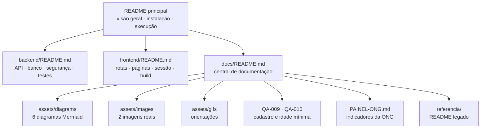

# 📚 Central de Documentação — Conecte-Bem

Bem-vindo à central de documentação do **Conecte-Bem**. Aqui estão reunidos os guias, diagramas, registros de QA e materiais de referência do projeto.

> Documentação geral: [README principal](../README.md) · Backend: [backend/README.md](../backend/README.md) · Frontend: [frontend/README.md](../frontend/README.md)

[](#9-convenções-da-documentação)
[](assets/diagrams/README.md)
[](../README.md)

---

## Sumário

- [1. Sobre esta central](#1-sobre-esta-central)
- [2. Mapa da documentação](#2-mapa-da-documentação)
- [3. Documentos principais](#3-documentos-principais)
- [4. Documentos de QA e funcionalidades](#4-documentos-de-qa-e-funcionalidades)
- [5. Diagramas](#5-diagramas)
- [6. Imagens e GIFs](#6-imagens-e-gifs)
- [7. Documentos históricos e complementares](#7-documentos-históricos-e-complementares)
- [8. Arquitetura em resumo](#8-arquitetura-em-resumo)
- [9. Convenções da documentação](#9-convenções-da-documentação)
- [10. Como manter a documentação](#10-como-manter-a-documentação)
- [11. Pendências e validações](#11-pendências-e-validações)

---

## 1. Sobre esta central

Esta pasta concentra materiais que complementam os READMEs dos módulos. A documentação foi escrita a partir do **código-fonte existente**, sem descrever funcionalidades planejadas como se estivessem concluídas.

**Princípios adotados:**

- fidelidade ao código e às configurações do repositório;
- linguagem clara em português brasileiro;
- separação entre documentação vigente e material histórico;
- uso de caminhos relativos, para funcionar no GitHub e em editores locais;
- identificação explícita de limitações e pendências;
- ausência de credenciais, tokens, senhas e dados pessoais.

**O que você encontra aqui:**

| Tipo de conteúdo | Onde está |
|---|---|
| Visão geral, instalação e execução | [README principal](../README.md) |
| API REST, banco, segurança e testes | [backend/README.md](../backend/README.md) |
| Páginas, rotas, componentes e integração | [frontend/README.md](../frontend/README.md) |
| Diagramas Mermaid | [`assets/diagrams/`](assets/diagrams/README.md) |
| Imagens reais do projeto | [`assets/images/`](assets/images/README.md) |
| Orientações para GIFs | [`assets/gifs/`](assets/gifs/README.md) |
| Registros de QA | [`QA-009-CADASTRO.md`](QA-009-CADASTRO.md) e [`QA-010-IDADE-MINIMA.md`](QA-010-IDADE-MINIMA.md) |
| Relatório de testes JUnit e Jest | [`../qa-report/RELATORIO-TESTES-JUNIT-JEST.md`](../qa-report/RELATORIO-TESTES-JUNIT-JEST.md) |
| Documento de funcionalidade | [`PAINEL-ONG.md`](PAINEL-ONG.md) |
| Contrato de inscrições | [`../backend/INSCRICOES-BACKEND.md`](../backend/INSCRICOES-BACKEND.md) |
| Integração da tela de inscritos | [`../backend/PENDENCIAS-VOLUNTARIOS-INSCRITOS.md`](../backend/PENDENCIAS-VOLUNTARIOS-INSCRITOS.md) |
| Auditoria técnica histórica | [`../AUDITORIA-PESSOA3-ETAPA1.md`](../AUDITORIA-PESSOA3-ETAPA1.md) |
| Material preservado | [`referencia/MODULO-ONG-README-LEGADO.md`](referencia/MODULO-ONG-README-LEGADO.md) |

---

## 2. Mapa da documentação



### Navegação por objetivo

| Quero… | Vá para… |
|---|---|
| Entender o projeto | [README principal](../README.md) |
| Rodar a aplicação | [Instalação e configuração](../README.md#12-instalação-e-configuração) |
| Conhecer a API | [Endpoints do backend](../backend/README.md#12-documentação-dos-endpoints) |
| Entender a autenticação | [Fluxo de autenticação](assets/diagrams/fluxo-autenticacao.mmd) |
| Ver o modelo de dados | [Modelo de dados](assets/diagrams/modelo-dados.mmd) |
| Navegar pelas telas | [Rotas do frontend](../frontend/README.md#5-rotas-e-páginas) |
| Consultar regras de cadastro | [QA-009](QA-009-CADASTRO.md) e [QA-010](QA-010-IDADE-MINIMA.md) |
| Entender o painel da ONG | [PAINEL-ONG.md](PAINEL-ONG.md) |
| Ver diagramas | [assets/diagrams](assets/diagrams/README.md) |

---

## 3. Documentos principais

### README principal

[`../README.md`](../README.md)

Cobre:

- visão geral, objetivo, problema e público-alvo;
- funcionalidades implementadas;
- tecnologias e arquitetura;
- estrutura de diretórios;
- pré-requisitos, instalação e banco;
- execução do backend e do frontend;
- testes;
- equipe;
- melhorias futuras e limitações.

### Backend

[`../backend/README.md`](../backend/README.md)

Cobre:

- tecnologias e arquitetura em camadas;
- estrutura de pacotes;
- modelagem do banco e relacionamentos;
- configuração do PostgreSQL e variáveis de ambiente;
- **31 endpoints** distribuídos em 8 controllers;
- métodos HTTP, parâmetros, exemplos e códigos de resposta;
- autenticação JWT e matriz de autorização;
- regras de negócio;
- 127 testes em 14 classes;
- considerações técnicas.

### Frontend

[`../frontend/README.md`](../frontend/README.md)

Cobre:

- tecnologias e arquitetura da SPA;
- estrutura de diretórios;
- 19 caminhos de rota, incluindo o curinga 404, e suas páginas;
- componentes, contexto e serviços;
- fluxo de autenticação e sessão;
- controle de acesso por perfil;
- variáveis de ambiente;
- instalação, execução, build e preview;
- testes de utilitários com `node:test`, testes de interface com Jest e lint;
- estilos, acessibilidade e limitações.

---

## 4. Documentos de QA e funcionalidades

### QA-009 — Dados coletados no cadastro

[`QA-009-CADASTRO.md`](QA-009-CADASTRO.md)

Registra a inclusão e persistência de:

- `cpf`, `dataNascimento` e `telefone` do voluntário;
- `dataCriacao` e `telefone` da ONG;
- campos anuláveis para preservar contas existentes;
- migração SQL necessária para bancos já criados;
- exposição dos dados apenas no perfil autenticado.

### QA-010 — Idade mínima no cadastro

[`QA-010-IDADE-MINIMA.md`](QA-010-IDADE-MINIMA.md)

Registra:

- obrigatoriedade de data de nascimento para novos voluntários;
- idade mínima de 18 anos;
- uso do fuso `America/Sao_Paulo`;
- tratamento de 29 de fevereiro;
- regra específica para ONGs;
- impacto no login com Google;
- comandos de validação.

### Painel da ONG

[`PAINEL-ONG.md`](PAINEL-ONG.md)

Documenta a tarefa **Pessoa 4 — Painel da ONG**:

- endpoint `GET /ongs/me/painel`;
- indicadores retornados;
- regras de contagem;
- decisão de identificar a ONG pelo JWT, sem receber `ongId`;
- proteção de `/ongs/me/**` para o papel `ONG`;
- testes relacionados.

> Esses documentos foram preservados como registros históricos do desenvolvimento. Quando houver divergência, prevalecem o código e os READMEs vigentes.

### Relatório consolidado de testes

[`../qa-report/RELATORIO-TESTES-JUNIT-JEST.md`](../qa-report/RELATORIO-TESTES-JUNIT-JEST.md)

Reúne o registro das suítes automatizadas executadas em **11/11/2026**:

- execução dos testes **JUnit** do backend com H2 em memória;
- configuração e execução dos **43 testes Jest** do frontend com Testing Library;
- escopo, comandos e ambiente de execução de cada suíte;
- resultado por classe de teste e observações de QA.

> O relatório preserva o registro daquela execução. As contagens atuais — **127 testes JUnit**, **5 testes `node:test`** e **43 testes Jest** — estão consolidadas nos READMEs dos módulos. Não há relatório de cobertura de linhas (JaCoCo ou equivalente).

---

## 5. Diagramas

Os diagramas são mantidos em **Mermaid**, em arquivos `.mmd` dentro de [`assets/diagrams/`](assets/diagrams/README.md), e também estão incorporados nos READMEs.

| Diagrama | Arquivo | Onde aparece |
|---|---|---|
| Arquitetura geral | [`arquitetura-geral.mmd`](assets/diagrams/arquitetura-geral.mmd) | README principal |
| Comunicação frontend → backend → banco | [`fluxo-comunicacao.mmd`](assets/diagrams/fluxo-comunicacao.mmd) | README principal |
| Camadas do backend | [`camadas-backend.mmd`](assets/diagrams/camadas-backend.mmd) | Backend |
| Fluxo de autenticação | [`fluxo-autenticacao.mmd`](assets/diagrams/fluxo-autenticacao.mmd) | Backend |
| Modelo de dados | [`modelo-dados.mmd`](assets/diagrams/modelo-dados.mmd) | README principal e backend |
| Estado da inscrição | [`estado-inscricao.mmd`](assets/diagrams/estado-inscricao.mmd) | Backend |

### Visualização

- **GitHub:** renderiza blocos `mermaid` automaticamente.
- **VS Code:** use uma extensão de preview Markdown com suporte a Mermaid.
- **Mermaid Live Editor:** cole o conteúdo do arquivo `.mmd` em <https://mermaid.live/>.
- **CLI:** ferramentas como `mmdc` podem gerar imagens a partir dos arquivos.

> Não foram gerados PNG/SVG dos diagramas nesta versão. Os arquivos-fonte `.mmd` são a referência.

---

## 6. Imagens e GIFs

### Imagens

[`assets/images/`](assets/images/README.md) contém duas imagens reais do projeto:

| Arquivo | Uso |
|---|---|
| [`foto-sobre.avif`](assets/images/foto-sobre.avif) | Página Sobre |
| [`foto-comofunc.avif`](assets/images/foto-comofunc.avif) | Página Como Funciona |

As imagens foram copiadas de `frontend/src/assets/` para que a documentação não dependa de caminhos externos a `docs/`.

### GIFs

[`assets/gifs/`](assets/gifs/README.md) contém apenas orientações. **Nenhum GIF foi incluído**, pois não havia capturas reais de fluxo disponíveis no repositório. Não foram criadas demonstrações fictícias.

Fluxos candidatos a GIF futuro:

1. cadastro de voluntário;
2. publicação de oportunidade pela ONG;
3. inscrição de voluntário;
4. confirmação de inscrito pela ONG.

---

## 7. Documentos históricos e complementares

### 7.1 Contrato do módulo de inscrições

[`../backend/INSCRICOES-BACKEND.md`](../backend/INSCRICOES-BACKEND.md)

Descreve o backend das candidaturas:

- rotas de criação, listagem, cancelamento e consulta de inscritos;
- contratos JSON usados pelo frontend;
- regra de identificação do usuário pelo JWT;
- preservação de inscrições canceladas no histórico.

### 7.2 Integração da tela “Voluntários Inscritos”

[`../backend/PENDENCIAS-VOLUNTARIOS-INSCRITOS.md`](../backend/PENDENCIAS-VOLUNTARIOS-INSCRITOS.md)

Registra a integração da tela do painel da ONG:

- endpoint `GET /oportunidades/{id}/inscricoes`;
- regras de acesso e propriedade;
- formato da resposta;
- dependências já atendidas pelo backend.

### 7.3 Auditoria técnica — Pessoa 3, Etapa 1

[`../AUDITORIA-PESSOA3-ETAPA1.md`](../AUDITORIA-PESSOA3-ETAPA1.md)

Registro histórico de auditoria do backend e do repositório. Contém informações de uma etapa anterior do desenvolvimento, como branch, commits e estado do código naquele momento. **Não representa necessariamente o estado atual**; consulte os READMEs vigentes.

### 7.4 README legado do módulo ONG

[`referencia/MODULO-ONG-README-LEGADO.md`](referencia/MODULO-ONG-README-LEGADO.md)

Este arquivo preserva o conteúdo do antigo `backend/README.md`, produzido durante a evolução do módulo de ONGs. Ele contém um aviso no topo indicando que:

- é material histórico;
- algumas afirmações podem estar desatualizadas;
- a documentação vigente é [`backend/README.md`](../backend/README.md).

A preservação evita perda de contexto sem confundir o leitor sobre qual documento é a fonte atual.

---

## 8. Arquitetura em resumo

| Camada | Tecnologia | Responsabilidade |
|---|---|---|
| Interface | React 19 + Vite 8 | SPA, rotas, formulários e estado de sessão |
| HTTP | `fetch` + JWT | Comunicação com a API e tratamento de erros |
| API | Spring Boot 4.1.1 + Java 21 | Controllers, DTOs, validações e autorização |
| Domínio | Services + validadores | Regras de negócio, propriedade e transações |
| Persistência | Spring Data JPA + PostgreSQL 16 | Entidades, repositórios e schema |
| Segurança | Spring Security + JWT HMAC256 + BCrypt | Autenticação stateless e papéis |
| Testes | JUnit + Spring Boot Test + H2 | 127 testes de backend em 14 classes |
| Testes de utilitários | `node:test` | 5 testes no frontend |
| Testes de interface | Jest + Testing Library | 43 testes em 6 arquivos |

### Banco de dados

Cinco tabelas:

```text
usuarios → ongs → oportunidades → inscricoes
                 ↑
             categorias
```

- `usuarios`: credenciais e dados comuns;
- `ongs`: perfil da organização, com vínculo 1:1 a `usuarios`;
- `categorias`: catálogo global de tipos de atividade;
- `oportunidades`: ações publicadas pelas ONGs;
- `inscricoes`: candidaturas de voluntários, com status.

O schema é mantido manualmente em `backend/db/schema.sql`, com `ddl-auto=validate`.

---

## 9. Convenções da documentação

### Idioma e estilo

- Português brasileiro.
- Títulos curtos e descritivos.
- Emojis usados com moderação, apenas em títulos principais.
- Tabelas para comparações, matrizes e referências.
- Blocos de código com linguagem indicada.
- Caminhos de arquivos em `code`.
- Links relativos entre documentos.

### Estrutura dos READMEs

1. Título e descrição.
2. Badges.
3. Links cruzados.
4. Sumário.
5. Seções numeradas.
6. Referências internas ao final.

### Diagramas

- Fonte em `.mmd` e bloco `mermaid` no Markdown.
- Nomes de entidades, rotas e tabelas iguais aos do código.
- Sem arquitetura idealizada.
- Ao alterar o diagrama, atualizar o `.mmd`, o README e esta central.

### Segurança da documentação

Não incluir:

- senhas reais ou exemplos que possam ser confundidos com credenciais válidas;
- tokens JWT completos;
- chaves de API;
- e-mails pessoais;
- CPF, CNPJ ou telefones reais;
- capturas com dados de usuários.

Variáveis sensíveis devem aparecer como placeholders:

```env
SPRING_DATASOURCE_PASSWORD=<sua-senha>
JWT_SECRET=<segredo-com-pelo-menos-32-caracteres>
```

---

## 10. Como manter a documentação

### Ao alterar uma rota ou endpoint

1. Atualize o controller ou a rota no código.
2. Verifique a matriz de autorização em `SecurityConfig`.
3. Atualize a tabela de endpoints no [backend](../backend/README.md#12-documentação-dos-endpoints).
4. Se a rota for consumida pela interface, atualize o [frontend](../frontend/README.md#8-serviços-e-integração-com-a-api).
5. Atualize os exemplos e códigos de resposta, se necessário.
6. Confira os links relativos.

### Ao alterar o banco

1. Atualize `db/schema.sql` e as migrações aplicáveis.
2. Atualize a modelagem no backend.
3. Atualize o diagrama [`modelo-dados.mmd`](assets/diagrams/modelo-dados.mmd).
4. Atualize o diagrama no README principal e no backend.
5. Registre a mudança nesta central, se for relevante.

### Ao adicionar uma tela

1. Declare a rota em `AppRoutes.jsx`.
2. Defina o guarda de acesso, se necessário.
3. Documente a página e os endpoints consumidos no frontend.
4. Atualize o mapa de navegação.
5. Adicione captura real em `assets/images/`, se houver.

### Ao adicionar um teste

1. Execute o teste localmente.
2. Atualize a contagem e a descrição no README do módulo.
3. Se o comando mudar, atualize os exemplos.
4. Não declare cobertura que não existe.

---

## 11. Pendências e validações

### Pendências documentais conhecidas

| Item | Situação |
|---|---|
| Capturas de tela | Apenas duas imagens institucionais; não há screenshots das telas |
| GIFs de fluxo | Nenhum incluído |
| Diagramas em PNG/SVG | Não gerados; fonte disponível em `.mmd` |
| Licença | Não definida no repositório |
| Versão de Node.js | Não fixada no projeto |
| `.env.example` | Não versionado |
| Documentação de API com OpenAPI/Swagger | Não existe no backend |
| Deploy e CI/CD | Não configurados |
| Relatório de cobertura de linhas | Não gerado (não há JaCoCo nem equivalente) |
| Testes E2E | Não existem; as suítes cobrem backend, utilitários e componentes |

### Validações recomendadas antes de publicar

- [ ] Abrir todos os links relativos desta central.
- [ ] Confirmar que os caminhos das imagens existem.
- [ ] Renderizar os seis diagramas Mermaid.
- [ ] Conferir a contagem de endpoints com os controllers.
- [ ] Conferir a matriz de autorização com `SecurityConfig`.
- [ ] Executar `.\mvnw.cmd test` no backend (127 testes).
- [ ] Executar `npm test` no frontend (5 testes `node:test`).
- [ ] Executar `npm run test:jest` no frontend (43 testes Jest).
- [ ] Executar `npm run build` e `npm run lint` no frontend.
- [ ] Confirmar que apenas arquivos de documentação foram alterados.

### Escopo desta documentação

Esta central **não** substitui:

- o código-fonte;
- os testes automatizados;
- as decisões registradas em issues ou pull requests;
- a documentação operacional de infraestrutura, que não existe no repositório.

---

## Referências internas

- [README principal](../README.md)
- [Backend](../backend/README.md)
- [Frontend](../frontend/README.md)
- [Diagramas](assets/diagrams/README.md)
- [Imagens](assets/images/README.md)
- [GIFs](assets/gifs/README.md)
- [QA-009 — Cadastro](QA-009-CADASTRO.md)
- [QA-010 — Idade mínima](QA-010-IDADE-MINIMA.md)
- [Painel da ONG](PAINEL-ONG.md)
- [README legado do módulo ONG](referencia/MODULO-ONG-README-LEGADO.md)
