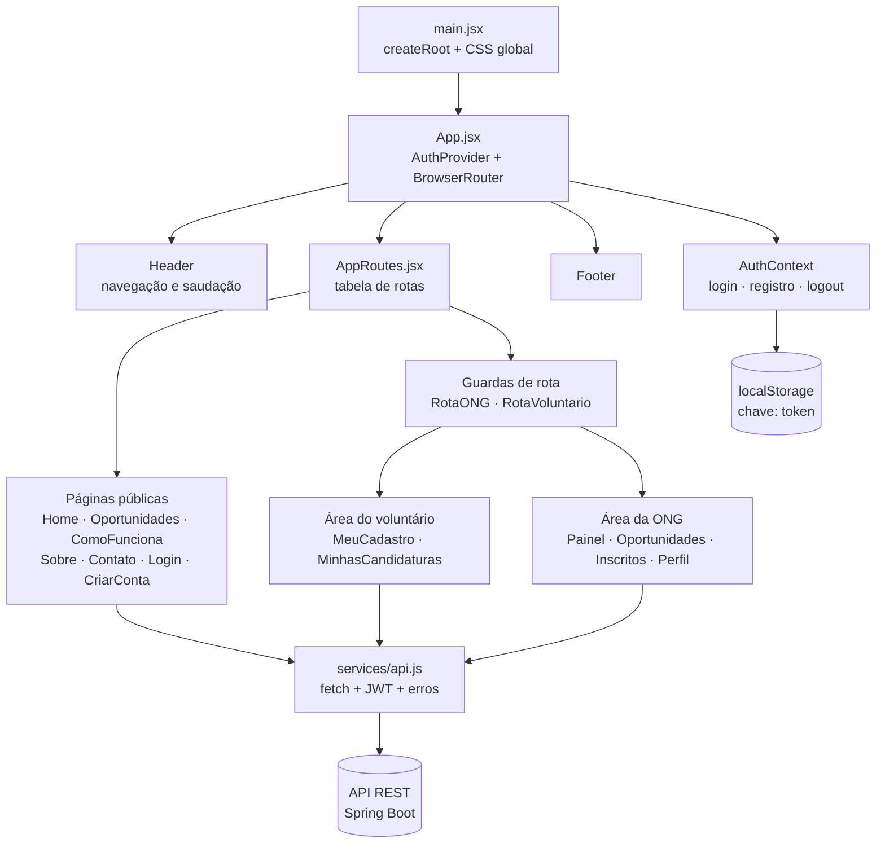
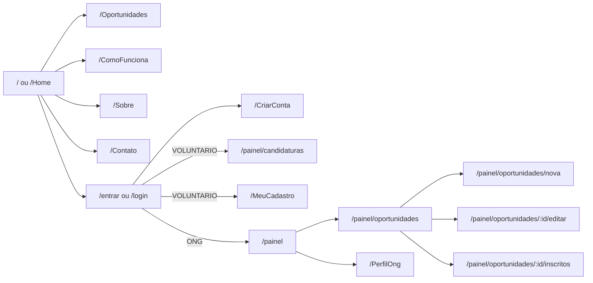
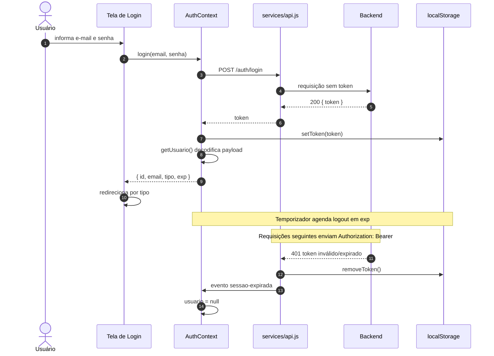

# 💻 Frontend — Conecte-Bem

Interface web do **Conecte-Bem**, construída com **React 19**, **React Router DOM 7** e **Vite 8**. Consome a API REST do backend para cadastro, autenticação, consulta de oportunidades, inscrições e gestão da área da ONG.

> Documentação geral: [README principal](../README.md) · Backend: [backend/README.md](../backend/README.md) · Central de docs: [docs/README.md](../docs/README.md)

[](https://react.dev/)
[](https://vite.dev/)
[](https://reactrouter.com/)
[](https://developer.mozilla.org/docs/Web/JavaScript)
[](#18-limitações-e-considerações)

---

## Sumário

- [1. Apresentação](#1-apresentação)
- [2. Tecnologias utilizadas](#2-tecnologias-utilizadas)
- [3. Arquitetura do frontend](#3-arquitetura-do-frontend)
- [4. Estrutura de diretórios](#4-estrutura-de-diretórios)
- [5. Rotas e páginas](#5-rotas-e-páginas)
- [6. Componentes](#6-componentes)
- [7. Contexto de autenticação](#7-contexto-de-autenticação)
- [8. Serviços e integração com a API](#8-serviços-e-integração-com-a-api)
- [9. Fluxo de autenticação e sessão](#9-fluxo-de-autenticação-e-sessão)
- [10. Controle de acesso por perfil](#10-controle-de-acesso-por-perfil)
- [11. Variáveis de ambiente](#11-variáveis-de-ambiente)
- [12. Instalação](#12-instalação)
- [13. Execução em desenvolvimento](#13-execução-em-desenvolvimento)
- [14. Build e pré-visualização](#14-build-e-pré-visualização)
- [15. Testes automatizados](#15-testes-automatizados)
- [16. Lint e qualidade de código](#16-lint-e-qualidade-de-código)
- [17. Estilos e recursos visuais](#17-estilos-e-recursos-visuais)
- [18. Limitações e considerações](#18-limitações-e-considerações)

---

## 1. Apresentação

O frontend do Conecte-Bem é uma **Single Page Application (SPA)** que oferece:

- páginas institucionais públicas (Início, Como Funciona, Sobre Nós e Contato);
- listagem pública de oportunidades com busca e filtros;
- cadastro e login de **voluntários** e **ONGs**;
- inscrição de voluntários em oportunidades;
- área do voluntário com perfil e candidaturas;
- área da ONG com painel, perfil, publicação, edição e cancelamento de oportunidades e gestão de inscritos;
- navegação adaptada ao perfil autenticado no cabeçalho.

A aplicação não renderiza HTML no servidor: o roteamento ocorre no navegador com `BrowserRouter`. Toda a persistência e as regras de autorização efetivas ficam no backend; o frontend apenas adapta a interface e envia o token JWT.

> Observação: o frontend **não** implementa login com Google, embora o backend exponha `POST /auth/google`. Também não existe endpoint ou fluxo funcional de recuperação de senha — a interface desse recurso é apenas visual (ver [seção 18](#18-limitações-e-considerações)).

---

## 2. Tecnologias utilizadas

### Dependências de execução

| Tecnologia | Versão declarada | Uso no projeto |
|---|---|---|
| React | `^19.2.8` | Componentes e estado da interface |
| React DOM | `^19.2.8` | Renderização no navegador |
| React Router DOM | `^7.18.5` | Rotas, `Link`, `NavLink`, `Navigate` e parâmetros de URL |
| Font Awesome Core | `^7.3.1` | Base dos ícones |
| Font Awesome Free Solid | `^7.3.1` | Ícones sólidos (Home, Sobre, modal) |
| Font Awesome React | `^3.5.0` | Componente `FontAwesomeIcon` |
| React Icons | `^5.7.0` | Ícones `io5` e `fa` (olho, busca, fechar, coração) |

### Dependências de desenvolvimento

| Tecnologia | Versão declarada | Uso no projeto |
|---|---|---|
| Vite | `^8.2.2` | Servidor de desenvolvimento e build |
| `@vitejs/plugin-react` | `^6.1.0` | Suporte a JSX e Fast Refresh |
| ESLint | `^10.9.0` | Análise estática |
| `@eslint/js` | `^10.0.1` | Configuração recomendada |
| `eslint-plugin-react-hooks` | `^7.1.1` | Regras de hooks |
| `eslint-plugin-react-refresh` | `^0.5.4` | Regras de Fast Refresh |
| `globals` | `^17.11.0` | Globais do navegador |
| `@types/react` / `@types/react-dom` | `^19.2.18` / `^19.2.4` | Tipos para suporte de editor |
| Jest | `^30.5.2` | Testes de componentes e serviços |
| `jest-environment-jsdom` | `^30.5.2` | Ambiente DOM nos testes |
| `@testing-library/react` / `dom` / `jest-dom` / `user-event` | `^16.3.3` / `^10.4.2` / `^7.0.1` / `^14.6.9` | Testes de interface |
| Babel (`core` / `preset-env` / `preset-react`) | `^8.1.2` / `^8.0.7` / `^8.0.1` | Transpilação de JSX nos testes |
| `babel-jest` | `^30.5.2` | Integração Babel + Jest |
| `identity-obj-proxy` | `^3.0.0` | Mock de importações CSS nos testes |

### O que não é usado

O projeto **não** utiliza TypeScript, framework CSS, biblioteca de estado global, Axios, React Query, Vitest ou SSR. As chamadas HTTP usam `fetch` nativo. Os testes de interface usam **Jest + Testing Library**.

---

## 3. Arquitetura do frontend

A aplicação é organizada em camadas simples e explícitas:



**Características da arquitetura:**

- `App.jsx` envolve toda a aplicação com `AuthProvider` e `BrowserRouter`.
- `Header` e `Footer` aparecem em todas as rotas.
- As páginas consomem a API diretamente por meio do wrapper `api()`.
- Não há camada de *store*: o estado é local por componente (`useState`) e compartilhado apenas para autenticação (`AuthContext`).
- As rotas protegidas são envolvidas por `RotaONG` ou `RotaVoluntario`.
- A maioria das páginas possui CSS próprio; `Login` reaproveita os estilos globais de `styles/global.css`.

---

## 4. Estrutura de diretórios

```text
frontend/
├── index.html
├── package.json
├── package-lock.json
├── vite.config.js
├── eslint.config.js
├── jest.config.js
├── jest.setup.js
├── public/
├── src/
│   ├── main.jsx
│   ├── App.jsx
│   ├── assets/
│   │   ├── foto-comofunc.avif
│   │   └── foto-sobre.avif
│   ├── componentes/
│   │   ├── Footer/
│   │   │   ├── Footer.jsx
│   │   │   └── Footer.css
│   │   └── Header/
│   │       ├── Header.jsx
│   │       ├── Header.css
│   │       ├── MenuOng.jsx
│   │       └── MenuVoluntario.jsx
│   ├── context/
│   │   ├── AuthContext.jsx
│   │   └── authContextValue.js
│   ├── hooks/
│   │   └── useAuth.js
│   ├── pages/
│   │   ├── ComoFunciona/
│   │   ├── Contato/
│   │   ├── CriarConta/
│   │   ├── FormOportunidade/
│   │   ├── GerenciarOportunidades/
│   │   ├── Home/
│   │   ├── Login/
│   │   ├── MinhasCandidaturas/
│   │   ├── NaoEncontrada/
│   │   ├── Oportunidade/
│   │   ├── PainelOng/
│   │   ├── PerfilOng/
│   │   ├── PerfilVoluntario/
│   │   ├── Sobre/
│   │   └── VoluntariosInscritos/
│   ├── routes/
│   │   ├── AppRoutes.jsx
│   │   ├── RotaONG/
│   │   └── RotaVoluntario/
│   ├── services/
│   │   ├── api.js
│   │   ├── auth.js
│   │   ├── idade.js
│   │   └── oportunidades.js
│   └── styles/
│       └── global.css
└── tests/
    ├── idade.test.mjs
    ├── oportunidades.test.mjs
    ├── jest/
    │   ├── api.test.jsx
    │   ├── auth.test.jsx
    │   ├── Contato.test.jsx
    │   ├── Header.test.jsx
    │   ├── Login.test.jsx
    │   ├── rotasProtegidas.test.jsx
    │   └── utils.jsx
    └── __mocks__/
        └── arquivoMock.js
```

### Responsabilidade dos diretórios

| Diretório | Responsabilidade |
|---|---|
| `src/assets/` | Imagens usadas nas páginas institucionais |
| `src/componentes/` | Cabeçalho, menus por perfil e rodapé |
| `src/context/` | Contexto React de autenticação e seu objeto de contexto |
| `src/hooks/` | Hook `useAuth` com validação de uso dentro do provider |
| `src/pages/` | Uma pasta por tela, com JSX e, na maioria, CSS próprio |
| `src/routes/` | Tabela de rotas e guardas por tipo de usuário |
| `src/services/` | HTTP, sessão JWT, cálculo de idade e regras de disponibilidade |
| `src/styles/` | Estilos globais, variáveis e componentes compartilhados |

> O estilo global é `src/styles/global.css`, importado em `main.jsx`. Não existe mais `src/App.css`.

---

## 5. Rotas e páginas

Todas as rotas são declaradas em [`src/routes/AppRoutes.jsx`](src/routes/AppRoutes.jsx).

| Rota | Página | Acesso | Finalidade |
|---|---|---|---|
| `/login` e `/entrar` | `Login` | Pública | Autenticação; redireciona usuário já logado |
| `/` e `/Home` | `Home` | Pública | Apresentação e áreas de voluntariado |
| `/Oportunidades` | `Oportunidades` | Pública | Listagem, busca, filtros, detalhes e inscrição |
| `/ComoFunciona` | `ComoFunciona` | Pública | Passo a passo para voluntários e ONGs |
| `/Sobre` | `Sobre` | Pública | Missão, visão, valores e atuação |
| `/Contato` | `Contato` | Pública | Formulário de contato por e-mail |
| `/CriarConta` | `CriarConta` | Pública | Cadastro de voluntário ou ONG |
| `/MeuCadastro` | `PerfilVoluntario` | Voluntário | Edição do perfil do voluntário |
| `/PerfilVoluntario` | `PerfilVoluntario` | Voluntário | Alias da rota anterior |
| `/painel/candidaturas` | `MinhasCandidaturas` | Voluntário | Inscrições do voluntário |
| `/painel` | `PainelOng` | ONG | Indicadores e últimas oportunidades |
| `/painel/oportunidades` | `GerenciarOportunidades` | ONG | Lista e cancelamento de oportunidades |
| `/painel/oportunidades/nova` | `FormOportunidade` | ONG | Criação de oportunidade |
| `/painel/oportunidades/:id/editar` | `FormOportunidade` | ONG | Edição de oportunidade |
| `/painel/oportunidades/:id/inscritos` | `VoluntariosInscritos` | ONG | Inscritos e confirmação/cancelamento |
| `/PerfilOng` | `PerfilOng` | ONG | Edição do perfil da organização |
| `*` | `NaoEncontrada` | Pública | Página 404 |

### Mapa de navegação



### 5.1 Detalhamento das páginas

#### Home

- Exibe o título “Conectando voluntários a ONGs” e seis áreas de voluntariado definidas localmente: Educação e Cultura, Saúde e Apoio Emocional, Meio Ambiente e Animais, Assistência Social e Comunitária, Voluntariado Digital e Turismo Social.
- Cada card abre um modal com descrição da área.
- O botão “Conhecer Oportunidades” leva a `/Oportunidades`.
- Não consome a API.

#### Oportunidades

- Carrega `GET /oportunidades` e `GET /categorias` em paralelo.
- Remove da listagem as oportunidades com status `CANCELADA`.
- Aplica filtros **em memória**: texto em título/descrição, categoria, ONG, somente abertas e localidades.
- As opções de ONG e localidade são derivadas dos próprios resultados.
- Se `GET /categorias` falhar, a listagem continua funcional e o filtro de categoria exibe aviso com botão de nova tentativa.
- O modal de detalhes permite que um voluntário autenticado envie `POST /inscricoes` com `{ oportunidadeId }`.
- Visitantes são convidados a entrar; contas ONG recebem aviso de que não podem se inscrever.
- A confirmação de inscrição é mantida apenas no estado da sessão da página.

#### Como Funciona

- Conteúdo institucional estático.
- Lista quatro passos para voluntários e quatro para ONGs.
- Usa a imagem `src/assets/foto-comofunc.avif`.
- Mostra “Criar conta” apenas para visitantes e sempre exibe “Ver oportunidades”.

#### Sobre

- Conteúdo institucional estático com missão, visão e valores.
- Usa a imagem `src/assets/foto-sobre.avif`.
- Mostra “Criar conta” apenas para visitantes.

#### Contato

- Formulário com nome, e-mail e mensagem.
- Envia `POST /contato` e exibe mensagem de sucesso ou erro retornado pela API.
- Limites do formulário: nome e e-mail com até 150 caracteres; mensagem com até 2.000.

#### Login

- Aceita e-mail e senha e chama `POST /auth/login`.
- Redireciona ONG para `/painel` e voluntário para `/Home`.
- Se já houver sessão válida, redireciona automaticamente.
- Exibe mensagem vinda de `location.state` (por exemplo, após criar conta).
- O link “Esqueci minha senha” abre um modal com e-mail e data de nascimento e apenas simula o envio; **não há chamada à API**.
- O modal implementa foco inicial, contenção de foco com `Tab`, fechamento com `Escape` e atributos ARIA.

#### CriarConta

- Alterna entre **Pessoa Física** (voluntário) e **Pessoa Jurídica** (ONG).
- Campos: e-mail, tipo, nome/razão social, data de nascimento/criação, CPF/CNPJ, telefone, senha e confirmação.
- CPF/telefone aceitam apenas dígitos; CNPJ exige 14 números.
- Pessoa Física exige 18 anos ou mais, com validação no cliente baseada no fuso `America/Sao_Paulo`.
- Envia `POST /auth/registro` com `nome`, `email`, `senha`, `tipo`, documento, data e telefone.
- Após o cadastro, tenta `POST /auth/login`; se falhar, redireciona para `/entrar` com mensagem de sucesso.
- Exibe/oculta senha e confirmação com ícones `IoEye`/`IoEyeOff`.

#### PerfilVoluntario (`/MeuCadastro` e `/PerfilVoluntario`)

- Carrega `GET /voluntarios/me`.
- Permite editar somente o **nome**; e-mail, CPF, data de nascimento e telefone são somente leitura.
- Salva com `PUT /voluntarios/me` enviando `{ nome }`.
- Mantém uma cópia dos dados salvos para a ação “Cancelar alterações”.

#### PerfilOng

- Carrega `GET /ongs/me`.
- Permite editar nome, descrição, telefone, cidade e estado (UF).
- CNPJ, data de criação e e-mail da conta são somente leitura.
- Salva com `PUT /ongs/me`.
- Oferece “Cancelar alterações” restaurando o último estado salvo.

#### PainelOng

- Carrega `GET /ongs/me/painel` e `GET /ongs/me/oportunidades` em paralelo.
- Exibe quatro indicadores: total de oportunidades, ativas, encerradas e voluntários inscritos.
- Lista as três oportunidades mais recentes por `criadoEm`.
- Oferece atalhos para criar oportunidade, gerenciar oportunidades e editar o perfil.

#### GerenciarOportunidades

- Carrega `GET /ongs/me/oportunidades`.
- Filtra por status: todas, aberta, encerrada e cancelada.
- Mostra categoria, data, horário, local, inscritos e vagas.
- “Cancelar” não exclui o registro: envia `PUT /oportunidades/{id}` com os dados atuais e `status: "CANCELADA"`, preservando histórico e inscritos.
- Links para editar e para ver inscritos.

#### FormOportunidade

- Mesmo componente para criar e editar, conforme a presença de `:id`.
- Carrega `GET /categorias` e `GET /ongs/me`.
- Na edição, carrega `GET /oportunidades/{id}` e bloqueia a tela se a oportunidade pertencer a outra ONG.
- Campos: título (até 150), categoria, descrição, data, horário, cidade, estado, vagas e status (status só na edição).
- Cria com `POST /oportunidades` e atualiza com `PUT /oportunidades/{id}`.
- Ao concluir, navega para `/painel/oportunidades`.

#### VoluntariosInscritos

- Carrega `GET /ongs/me` e `GET /oportunidades/{id}`; valida a propriedade da oportunidade.
- Carrega `GET /oportunidades/{id}/inscricoes`.
- Exibe nome, e-mail (link `mailto:`) e status da inscrição.
- Confirma com `PUT /inscricoes/{id}/confirmar`.
- Cancela com `PUT /inscricoes/{id}/recusar`, após confirmação do navegador.

#### MinhasCandidaturas

- Carrega `GET /inscricoes/me`.
- Filtra por todas, ativas, finalizadas e canceladas, combinando status da inscrição e da oportunidade.
- Permite expandir detalhes de local e descrição.
- Cancela com `DELETE /inscricoes/{id}` e atualiza o status local para `CANCELADA`.

#### NaoEncontrada

- Renderizada para qualquer rota não mapeada (`*`).
- Oferece caminho de volta à navegação principal.

---

## 6. Componentes

### Header

[`src/componentes/Header/Header.jsx`](src/componentes/Header/Header.jsx)

- Exibe logo, navegação principal (Início, Oportunidades, Como Funciona, Sobre nós) e área de conta.
- Para visitantes: links “Entrar” e “Criar Conta”.
- Para usuários autenticados: saudação com o nome do perfil e botão “Sair”.
- Busca o nome em `GET /ongs/me` ou `GET /voluntarios/me`, conforme o tipo; se falhar, mostra apenas “Olá!”.
- Atualiza `document.title` conforme o perfil: `Conecte-Bem`, `Conecte-Bem | Voluntário` ou `Conecte-Bem | ONG`.
- Ao sair, remove o token e navega para `/Home`.
- Renderiza o menu secundário adequado ao perfil.

### MenuVoluntario

- Links “Meu cadastro” (`/MeuCadastro`) e “Minhas inscrições” (`/painel/candidaturas`).
- Usa `Link` e marca `aria-current="page"` conforme o caminho atual.

### MenuOng

- Links “Painel da ONG”, “Minhas oportunidades” e “Perfil da ONG”.
- Usa `NavLink`, com destaque automático da rota ativa.

### Footer

- Conteúdo institucional e links para Oportunidades, Como funciona, Para ONGs, Entrar, Criar conta, Recuperar senha, Nossa história e Contato.
- O link “Recuperar senha” aponta para `/entrar`; não existe rota dedicada.
- Exibe o aviso de projeto final de conclusão +Prati.

> O rodapé usa uma tag `<a href="/">` no logotipo, o que provoca recarregamento completo da página em vez de navegação SPA.

---

## 7. Contexto de autenticação

### `AuthContext` / `AuthProvider`

Arquivos: [`src/context/AuthContext.jsx`](src/context/AuthContext.jsx) e [`src/context/authContextValue.js`](src/context/authContextValue.js).

O provider expõe:

| Item | Tipo | Comportamento |
|---|---|---|
| `usuario` | `{ id, email, tipo, exp } \| null` | Restaurado do JWT no `localStorage` |
| `login(email, senha)` | `async` | Chama `POST /auth/login`, salva o token e devolve o usuário |
| `registrar(dados)` | `async` | Chama `POST /auth/registro` sem iniciar sessão |
| `logout()` | função | Remove o token e zera o usuário |

Comportamentos implementados:

- Na inicialização, se existir token sem payload decodificável, o token é removido.
- Ouve o evento `conectebem:sessao-expirada`, disparado por `api.js` em respostas `401`.
- Sincroniza a sessão entre abas pelo evento `storage` do navegador.
- Agenda `logout` automático no instante `exp` do JWT.
- Usa `useMemo` para estabilizar o valor do contexto.

### `useAuth`

[`src/hooks/useAuth.js`](src/hooks/useAuth.js) encapsula `useContext` e lança erro se usado fora de `<AuthProvider>`.

---

## 8. Serviços e integração com a API

### `services/api.js`

Wrapper único sobre `fetch`:

```js
const API_URL = import.meta.env.VITE_API_URL || 'http://localhost:8080';

const token = caminho.startsWith('/auth/') ? null : getToken();
if (token) headers.Authorization = `Bearer ${token}`;
```

Regras relevantes:

- `Content-Type: application/json` é enviado apenas quando há corpo.
- Rotas iniciadas por `/auth/` **nunca** enviam token, evitando transformar credencial inválida em “sessão expirada”.
- `204 No Content` retorna `null`.
- Falha de rede gera `Não foi possível conectar ao servidor.`
- `401` com token enviado remove o token, dispara `EVENTO_SESSAO_EXPIRADA` e gera `Sua sessão expirou. Entre novamente.`
- `403` usa a mensagem do backend ou `Você não tem permissão para realizar esta ação.`
- Demais erros usam `dados.mensagem` ou `Erro inesperado. Tente novamente.`

### `services/auth.js`

Centraliza a sessão:

| Exportação | Função |
|---|---|
| `CHAVE_TOKEN` | Constante `token` usada no `localStorage` |
| `EVENTO_SESSAO_EXPIRADA` | Nome do evento `conectebem:sessao-expirada` |
| `getToken()` | Lê o JWT |
| `setToken(token)` | Grava o JWT |
| `removeToken()` | Remove o JWT |
| `getUsuario()` | Decodifica o payload e devolve `{ id, email, tipo, exp }` |
| `isOng()` | Verifica `tipo === 'ONG'` |
| `isVoluntario()` | Verifica `tipo === 'VOLUNTARIO'` |

A decodificação usa `atob` com tratamento de Base64URL e `decodeURIComponent`. O token é considerado inválido se estiver expirado ou malformado.

> A leitura do payload no navegador serve apenas para a interface. A validação criptográfica e as autorizações são feitas pelo backend.

### `services/idade.js`

- `hojeNoBrasil()` retorna a data atual no fuso `America/Sao_Paulo` no formato `AAAA-MM-DD`.
- `limiteNascimento(hoje)` calcula a data máxima permitida para quem completa 18 anos, tratando anos bissextos.

### `services/oportunidades.js`

| Exportação | Função |
|---|---|
| `motivoIndisponibilidade(oportunidade, hoje)` | Devolve o motivo de bloqueio da inscrição: oportunidade não `ABERTA`, data já passada ou vagas esgotadas. |
| `candidaturaCancelada(candidatura)` | Identifica candidatura cancelada pela inscrição ou pela oportunidade. |
| `pertenceAoFiltro(candidatura, filtro)` | Aplica os filtros `todas`, `ativas`, `finalizadas` e `canceladas` na tela de candidaturas. |

### Endpoints consumidos pelo frontend

| Método | Endpoint | Onde é usado |
|---|---|---|
| `POST` | `/auth/registro` | CriarConta |
| `POST` | `/auth/login` | Login, CriarConta, AuthContext |
| `POST` | `/contato` | Contato |
| `GET` | `/categorias` | Oportunidades, FormOportunidade |
| `GET` | `/oportunidades` | Oportunidades |
| `GET` | `/oportunidades/{id}` | FormOportunidade, VoluntariosInscritos |
| `POST` | `/oportunidades` | FormOportunidade |
| `PUT` | `/oportunidades/{id}` | FormOportunidade, GerenciarOportunidades |
| `GET` | `/oportunidades/{id}/inscricoes` | VoluntariosInscritos |
| `POST` | `/inscricoes` | Oportunidades |
| `GET` | `/inscricoes/me` | MinhasCandidaturas |
| `DELETE` | `/inscricoes/{id}` | MinhasCandidaturas |
| `PUT` | `/inscricoes/{id}/confirmar` | VoluntariosInscritos |
| `PUT` | `/inscricoes/{id}/recusar` | VoluntariosInscritos |
| `GET` | `/ongs/me` | Header, PerfilOng, FormOportunidade, VoluntariosInscritos |
| `PUT` | `/ongs/me` | PerfilOng |
| `GET` | `/ongs/me/painel` | PainelOng |
| `GET` | `/ongs/me/oportunidades` | PainelOng, GerenciarOportunidades |
| `GET` | `/voluntarios/me` | Header, PerfilVoluntario |
| `PUT` | `/voluntarios/me` | PerfilVoluntario |

Detalhes de contrato, payloads e códigos de erro: [backend/README.md](../backend/README.md).

---

## 9. Fluxo de autenticação e sessão



### Regras de sessão

1. O token é salvo em `localStorage` na chave `token`.
2. O payload esperado contém `sub` (e-mail), `id`, `tipo` (`ONG` ou `VOLUNTARIO`) e `exp`.
3. A sessão é restaurada ao recarregar a página.
4. Token expirado ou corrompido é descartado.
5. O logout automático ocorre no vencimento e também em respostas `401`.
6. Alterações na chave `token` em outra aba atualizam a sessão local.

> Não há refresh token. Quando o JWT expira, o usuário precisa autenticar-se novamente.

---

## 10. Controle de acesso por perfil

### Guardas de rota

| Guarda | Regra | Redirecionamento |
|---|---|---|
| `RotaONG` | `usuario.tipo === 'ONG'` | `/entrar` |
| `RotaVoluntario` | `usuario.tipo === 'VOLUNTARIO'` | `/entrar` |

As guardas são apenas de interface. O backend revalida o papel em cada endpoint protegido.

### Matriz de telas por perfil

| Tela | Visitante | Voluntário | ONG |
|---|---|---|---|
| Home, Como Funciona, Sobre, Contato, Oportunidades | ✅ | ✅ | ✅ |
| Login e CriarConta | ✅ | redireciona | redireciona |
| MeuCadastro / PerfilVoluntario | ❌ | ✅ | ❌ |
| MinhasCandidaturas | ❌ | ✅ | ❌ |
| Painel, Oportunidades, Inscritos e Perfil da ONG | ❌ | ❌ | ✅ |

### Ações sensíveis

- Inscrição em oportunidade: apenas voluntário autenticado.
- Criação/edição/cancelamento de oportunidade: backend valida que a oportunidade pertence à ONG autenticada; a interface também compara `ongId`.
- Inscritos: a tela verifica a propriedade antes de buscar a lista; o backend repete a validação.

---

## 11. Variáveis de ambiente

O frontend usa apenas uma variável:

| Variável | Obrigatória | Padrão | Descrição |
|---|---|---|---|
| `VITE_API_URL` | Não | `http://localhost:8080` | URL base da API REST |

Exemplo de `.env` local (não versionado):

```env
VITE_API_URL=http://localhost:8080
```

Observações:

- O projeto **não** versiona `.env` nem `.env.example`.
- `.env` e `.env.local` estão no `.gitignore`.
- Variáveis Vite precisam começar com `VITE_` para serem expostas ao navegador.
- Não há proxy configurado no `vite.config.js`; o navegador chama a API diretamente.
- Em produção, a URL da API deve ser definida no momento do build.

---

## 12. Instalação

### Pré-requisitos

- **Node.js** e **npm** instalados.
- O projeto **não fixa** versão de Node em `engines`, `.nvmrc` ou `.node-version`. Use uma versão compatível com Vite 8 e React 19.
- Backend em execução para as funcionalidades que consomem a API.

### Passos

```bash
cd frontend
npm install
```

O comando usa o `package-lock.json` e instala as versões resolvidas das dependências.

Para instalação reprodutível em CI:

```bash
npm ci
```

---

## 13. Execução em desenvolvimento

```bash
cd frontend
npm run dev
```

O Vite inicia o servidor de desenvolvimento e imprime a URL local (por padrão, `http://localhost:5173`).

Boas práticas para o ambiente local:

1. Suba o backend em `http://localhost:8080`.
2. Confirme `GET /health` no backend.
3. Se a API estiver em outro endereço, defina `VITE_API_URL` em `.env`.
4. Reinicie o servidor Vite após alterar variáveis de ambiente.

> O backend precisa permitir a origem do frontend na configuração de CORS. Consulte [backend/README.md](../backend/README.md).

---

## 14. Build e pré-visualização

### Build de produção

```bash
npm run build
```

O resultado é gerado em `frontend/dist/`.

### Pré-visualizar o build

```bash
npm run preview
```

O comando serve localmente o conteúdo de `dist/` para conferência.

### Implantação

O projeto não inclui configuração de hospedagem, Docker, CI/CD ou regras de servidor. Como o roteamento é feito no cliente com `BrowserRouter`, um servidor estático em produção precisa redirecionar rotas desconhecidas para `index.html`; caso contrário, acessos diretos a rotas como `/painel` podem retornar 404 do servidor.

---

## 15. Testes automatizados

O frontend possui duas suítes independentes: o runner nativo do Node (`node:test`) para utilitários e o **Jest + Testing Library** para componentes, rotas e serviços.

### 15.1 Runner nativo do Node

Script `npm test` (`node --test`). Arquivos:

- [`tests/idade.test.mjs`](tests/idade.test.mjs)
- [`tests/oportunidades.test.mjs`](tests/oportunidades.test.mjs)

**Testes atuais — 5 testes:**

1. Limite de 18 anos, incluindo 29 de fevereiro em ano bissexto.
2. Data no fuso `America/Sao_Paulo` antes da meia-noite local.
3. Disponibilidade considerando vagas restantes, data e status.
4. Cancelamento da oportunidade classifica candidatura ativa como cancelada.
5. Cancelamento individual não vira candidatura finalizada.

```bash
cd frontend
npm test
```

### 15.2 Jest + Testing Library

Script `npm run test:jest`. Configuração em [`jest.config.js`](jest.config.js) e [`jest.setup.js`](jest.setup.js).

**Testes atuais — 43 testes em 6 arquivos** (`tests/jest/`):

| Arquivo | Foco |
|---|---|
| `api.test.jsx` | Wrapper `fetch`, cabeçalhos, erros e sessão expirada. |
| `auth.test.jsx` | Token, decodificação e sessão. |
| `Contato.test.jsx` | Formulário e retorno da API. |
| `Header.test.jsx` | Navegação e nome do perfil. |
| `Login.test.jsx` | Autenticação, redirecionamento e modal de recuperação. |
| `rotasProtegidas.test.jsx` | Guardas `RotaONG` e `RotaVoluntario`. |

```bash
cd frontend
npm install        # instala as dependências de desenvolvimento
npm run test:jest
```

A configuração usa `jsdom`, `identity-obj-proxy` para importações CSS e um mock para imagens (`tests/__mocks__/arquivoMock.js`).

> Não há testes E2E com navegador nem relatório de cobertura de linhas. Os resultados consolidados das suítes JUnit e Jest estão em [`qa-report/RELATORIO-TESTES-JUNIT-JEST.md`](../qa-report/RELATORIO-TESTES-JUNIT-JEST.md).

---

## 16. Lint e qualidade de código

```bash
npm run lint
```

Configuração em [`eslint.config.js`](eslint.config.js):

- `@eslint/js` com regras recomendadas;
- `eslint-plugin-react-hooks` (configuração flat recomendada);
- `eslint-plugin-react-refresh` (configuração para Vite);
- globais de navegador;
- parser com suporte a JSX;
- `dist` ignorado.

### Convenções observadas no código

- Componentes em PascalCase e arquivos `.jsx`.
- Serviços e hooks em camelCase e arquivos `.js`.
- CSS por componente/página, com BEM informal em algumas classes.
- Textos de interface em português brasileiro.
- Uso de `aria-label`, `role`, `aria-current` e foco controlado em pontos específicos.
- Datas `AAAA-MM-DD` formatadas por manipulação de string para evitar deslocamento de fuso.

---

## 17. Estilos e recursos visuais

### Organização

- `src/styles/global.css` — reset, variáveis, tipografia, botões e formulários compartilhados.
- CSS por componente: `Header.css`, `Footer.css`.
- CSS por página: a maioria das telas possui arquivo próprio. A página **Login** reaproveita os estilos globais de `global.css` e não tem CSS próprio.

### Recursos visuais

| Recurso | Origem |
|---|---|
| Ícones de áreas, missão, visão e valores | Font Awesome Free Solid |
| Olho de senha, busca, fechar e coração | React Icons (`io5` e `fa`) |
| Foto da página Como Funciona | `src/assets/foto-comofunc.avif` |
| Foto da página Sobre | `src/assets/foto-sobre.avif` |

As imagens também estão disponíveis na central de documentação: [docs/assets/images](../docs/assets/images/).

### Responsividade

O layout usa CSS próprio, com `flexbox`, `grid` e media queries nas folhas de estilo das páginas e componentes. Não há framework utilitário nem tema centralizado de breakpoints documentado.

### Acessibilidade

Foram identificados no código:

- rótulos associados a campos;
- mensagens com `role="alert"` e `role="status"`;
- `aria-label` em navegações e botões de fechar;
- `aria-modal` e contenção de foco no modal de recuperação de senha;
- `aria-pressed` nos filtros;
- textos alternativos nas imagens.

Não há auditoria formal de acessibilidade nem testes com leitores de tela documentados.

---

## 18. Limitações e considerações

Itens identificados no código atual, apresentados como pendências e não como funcionalidades prontas:

| Item | Situação |
|---|---|
| Recuperação de senha | Apenas interface; o modal simula envio e não chama a API |
| Login com Google | Backend expõe `POST /auth/google`, mas não há botão ou fluxo no frontend |
| Link “Recuperar senha” no rodapé | Aponta para `/entrar`; não existe rota dedicada de recuperação |
| TypeScript | Não utilizado |
| Estado global | Apenas autenticação; dados são recarregados por página |
| Cache de requisições | Inexistente |
| Atualização em tempo real | Inexistente |
| Upload de imagens | Inexistente |
| Internacionalização | Textos fixos em português |
| Paginação | A API de oportunidades é paginada (`page`/`size`), mas as telas carregam apenas a primeira página retornada |
| Refresh token | Inexistente; sessão encerra no `exp` |
| Armazenamento do JWT | `localStorage`, acessível a JavaScript da página |
| `.env.example` | Não versionado |
| Versão de Node | Não fixada no projeto |
| Deploy/CI | Não configurados no repositório |
| Cobertura de testes | Não há relatório de cobertura de linhas; as suítes cobrem utilitários, serviços, componentes e guardas |

### Observações de segurança

- O frontend decodifica o JWT sem verificar assinatura; isso serve apenas para exibir estado e redirecionar. A autorização real é do backend.
- Como o token fica em `localStorage`, qualquer XSS bem-sucedido poderia lê-lo. Não há Content Security Policy configurada no projeto.
- Rotas protegidas no cliente não substituem a validação server-side.

### Próximos passos sugeridos

1. Conectar a recuperação de senha a um endpoint real, quando existir.
2. Ampliar os testes Jest para os fluxos ainda sem cobertura e adicionar relatório de cobertura.
3. Criar `.env.example` e documentar a versão de Node recomendada.
4. Avaliar code splitting por rota para reduzir o bundle inicial.
5. Definir estratégia de deploy com fallback para `index.html`.
6. Adicionar testes E2E com navegador.

---

## Referências internas

- [README principal](../README.md)
- [Documentação do backend](../backend/README.md)
- [Central de documentação](../docs/README.md)
- [Diagramas](../docs/assets/diagrams/README.md)
- [Imagens](../docs/assets/images/README.md)
- [GIFs](../docs/assets/gifs/README.md)
- [Documentação do painel da ONG](../docs/PAINEL-ONG.md)
- [QA-009 — Cadastro](../docs/QA-009-CADASTRO.md)
- [QA-010 — Idade mínima](../docs/QA-010-IDADE-MINIMA.md)
